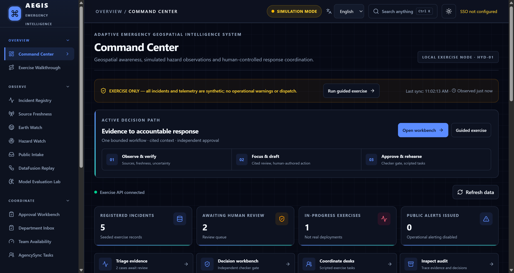
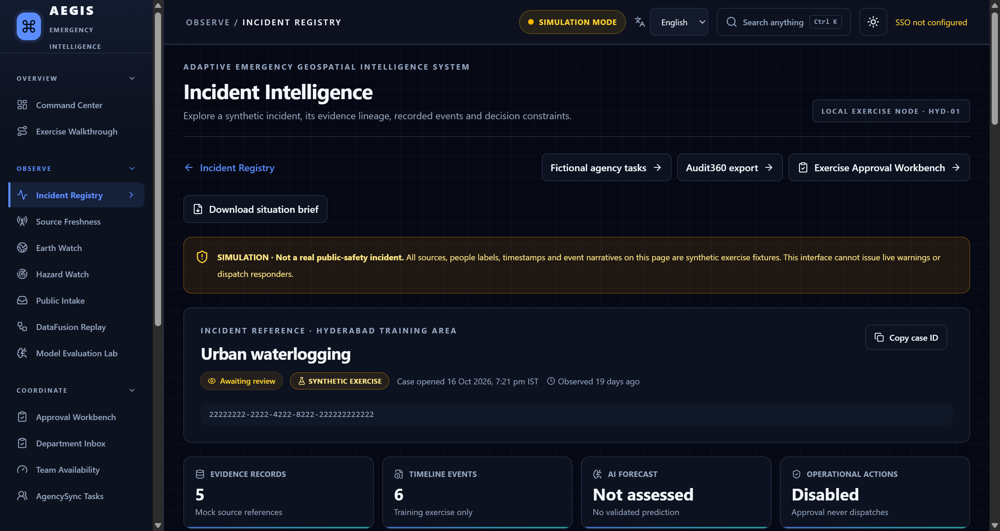
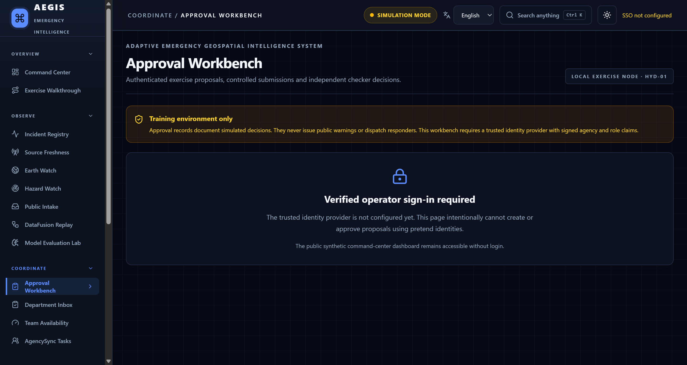
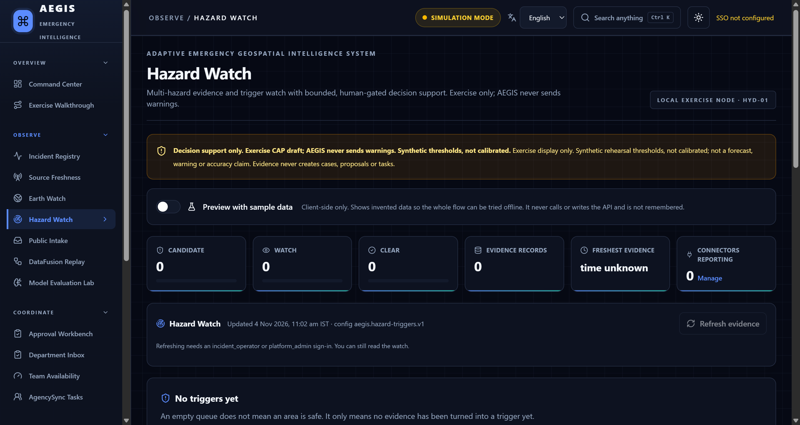

# AEGIS — Adaptive Emergency Geospatial Intelligence System

CipherCop 2026 · AI-powered disaster prediction, preparedness and accountable response.

> **Local synthetic exercise system.** AEGIS sends no real warnings, dispatches no responders and
> makes no validated forecasting claims. All metrics are synthetic unless a registered protocol says otherwise.

## What it is

AEGIS is a decision-support workbench for emergency operations centres. It gathers hazard evidence,
correlates it with incidents on a map, drafts response proposals with cited evidence, and routes them
through an **independent two-person (maker–checker) approval** before any exercise task or CAP
warning draft is produced. Automation prepares and explains; humans decide; the authority issues.

## Screenshots

| Command Center | Incident workspace |
|---|---|
|  |  |
| **Approvals workbench** | **Hazard Watch** |
|  |  |

## Architecture

```
 Browser (Next.js 15 / React, MapLibre, Tailwind)  ── en / te / hi, light / dark, 2D default + 3D locators
        │  same-origin only
        ▼
 Next.js BFF route handlers ── OIDC login (PKCE, state, nonce) · encrypted HttpOnly session (A256GCM)
        │  Origin-checked writes · field allowlists · bearer token from server-side session only
        ▼
 FastAPI service (Python) ── RS256 JWT verification · signed agency/role/department scope
        │  maker–checker governance · row-locked transitions with atomic audit
        │  assessment · spatial correlation · source health · replay · model lab · CAP export
        │  opt-in: local copilot · Earth Watch · public intake (quarantine) · proactive watch
        ▼
 PostgreSQL + PostGIS ── immutable proposal snapshots · audit trail · exercise fixtures
        ▲
 Allowlisted HTTPS adapters (no redirects, fixed hosts): Open-Meteo, USGS, NASA FIRMS/EONET, …
```

More detail: [architecture decisions](docs/ARCHITECTURE.md) · [security and governance](docs/SECURITY_AND_GOVERNANCE.md).

## Why it is designed this way

| Decision | Reason |
|---|---|
| Human maker–checker on every consequential step | In disaster response a wrong warning costs trust and lives; accountability must sit with two named people, not a model. |
| Backend-for-frontend with server-held tokens | Tokens never reach browser JavaScript, so XSS cannot steal them; every write is same-origin checked. |
| Agency, role and department only from signed tokens | Browser-supplied scope can be forged; authority must come from the identity provider. |
| Cited evidence and abstention over free-text AI | Operators need to verify every claim; unsupported questions abstain instead of guessing. |
| Bounded, cancellable, draft-only agent runs | Automation gets a fixed step budget and stops before submission, so it can help without acting. |
| Default-off overlays (`compose.*.yaml`) | New capabilities ship without changing the base stack; each one is opted into and reviewed. |
| PostGIS and immutable snapshots | Spatial correlation needs real geometry; approvals must reference exactly what the checker saw. |
| Local-first, no paid infrastructure | Runs on one laptop for demos and tabletop exercises with no cost or data leaving the machine. |

## Install and run (Windows)

**Prerequisites:** Windows 10/11, [Docker Desktop](https://www.docker.com/products/docker-desktop/) with WSL2,
Git, PowerShell. For local code checks also Node.js 20+ and Python 3.12.

```powershell
git clone https://github.com/adityapuppala1/AI-Project-AEGIS.git
cd AI-Project-AEGIS
Copy-Item .env.example .env          # local-only values; never commit .env

# Start Docker Desktop first, then:
powershell -ExecutionPolicy Bypass -File .\scripts\start-windows.ps1
powershell -ExecutionPolicy Bypass -File .\scripts\check-local-runtime.ps1 -RequireRunning
powershell -ExecutionPolicy Bypass -File .\scripts\verify-windows.ps1
```

Open http://localhost:3000 (app), http://localhost:3000/demo (guided exercise) and
http://localhost:8000/docs (API). Stop with `scripts\stop-windows.ps1`; the database volume is kept.

Optional overlays (default off): `-LocalCopilot`, `-PublicEarth`, `-PublicIntake`, `-Proactive`
(the last needs `AEGIS_CONNECTOR_KEY`, see `scripts/new-connector-key.ps1`). Sign-in for the approval
workbench needs an OIDC identity provider; see [local IdP review](docs/LOCAL_IDP_REVIEW.md).
Run one AEGIS stack at a time ([single-instance rules](docs/SINGLE_INSTANCE_LOCAL_RUNTIME.md)).
Full setup and troubleshooting: [Windows local setup](docs/WINDOWS_LOCAL_SETUP.md).

**Local checks**

```powershell
cd services/api; python -m venv .venv; .\.venv\Scripts\pip install -r requirements.txt
.\.venv\Scripts\python -m pytest -q; .\.venv\Scripts\python -m app.model_lab --check
cd ..\..\apps\web; npm ci --no-audit --no-fund; npm run typecheck; npm run build
```

## Roadmap

[Agentic and proactive roadmap](docs/AGENTIC_PROACTIVE_ROADMAP.md) ·
[proactive multi-hazard plan](docs/PROACTIVE_MULTI_HAZARD_PLAN.md) ·
[engineering backlog](docs/ENGINEERING_BACKLOG.md).

## Status

**Consolidated synthetic demo release candidate (in development).** The latest integrated branch is `feat/ciphercop-integrated-demo-rc`, combining the original GeoCommand, DataFusion, Incident Fusion, response guidance, ApprovalGuard, AgencySync, PolicyStudio, ReplayLab and Audit360 demo surfaces. **No real warnings, dispatch or validated flood forecasting.** The current release candidate still requires tests and owner approval; `main` is unchanged.

**Latest verified local continuation:** `feat/aegis-local-demo-continuation` (transferred locally; not pushed). See [current handoff](docs/LOCAL_DEMO_HANDOFF.md).

**Manual release evidence:** use the fillable [demo rehearsal and human
acceptance record](docs/DEMO_REHEARSAL.md). Human accessibility/operator review
and the deferred two-person IdP rehearsal remain open until recorded there.

**Start here:** [Original-plan reconciliation and acceptance gates](docs/CIPHERCOP_2026_RELEASE_AUDIT.md) · [Guided exercise](http://localhost:3000/demo) (after local startup).

```powershell
# Run from the verified continuation checkout. Inspect git status before switching branches.
powershell -ExecutionPolicy Bypass -File .\scripts\start-windows.ps1
powershell -ExecutionPolicy Bypass -File .\scripts\check-local-runtime.ps1 -RequireRunning
powershell -ExecutionPolicy Bypass -File .\scripts\verify-windows.ps1
```

An optional local-only scenario refresh (`scripts/run-tabletop-windows.ps1 -ConfirmExercise`) appends three fictional readings without deleting source history. The `/demo` page guides the original scenario through the rule-only index, case evidence, playbook, human approval gate, scripted AgencySync acknowledgements and Audit360 export. No official provider is connected.

Use the [single-instance local helpers](docs/SINGLE_INSTANCE_LOCAL_RUNTIME.md):
one AEGIS stack and one managed startup/build/test/replay operation at a time.
Do not launch native dev servers alongside Compose or stop unrelated projects.

## Current continuation and validation

See [local demo handoff](docs/LOCAL_DEMO_HANDOFF.md) for current branch, commands,
results and remaining gates. New demo-agency approval drafts retain the case
assessment and playbook citations. After independent approval, an operator can
prepare proposal-linked scripted desk tasks, record acknowledgements/closure
with rationale, and inspect their private
audit JSON in `/approvals`. A trusted IdP remains required; no pretend login is
provided. Public AgencySync/Audit360 remain separate fixture views.
[Staged task scope](docs/STAGED_TASK_REHEARSAL.md) explains retries and legacy receipts.
The incident [context panel](docs/INCIDENT_CONTEXT_PANEL.md) exposes freshness
evaluation time, missing context and explicit unknowns without inventing a forecast.
A [cited template review brief](docs/CITED_REVIEW_BRIEF.md) summarizes checked
records and review options; new proposals preserve it for checker review.
An optional [local model review focus](docs/LOCAL_REVIEW_FOCUS.md) selects existing
review items on demand; base startup uses a labelled template fallback.
Operators can opt in to [save a selection with a draft](docs/SAVED_REVIEW_FOCUS.md)
for later independent review; see the handoff for verification status.
Draft makers can also use a [bounded durable assistance run](docs/BOUNDED_ASSISTANCE_RUN.md)
to check captured references and quality one explicit step at a time before submission.
Approved warning-preparation proposals also support a private
[exercise CAP XML draft](docs/CAP_EXERCISE_DRAFTS.md) download; no messages are sent.

For a case-linked local replay, run:

```powershell
powershell -ExecutionPolicy Bypass -File .\scripts\replay-windows.ps1 -IncidentId 22222222-2222-4222-8222-222222222222
```

Accepted observations become idempotent case evidence with original times and
quality labels. Create a new draft afterward to capture those citations.
For builds behind a trusted HTTPS proxy, see
[local build and handoff notes](docs/LOCAL_DEMO_HANDOFF.md#docker-builds-behind-a-trusted-https-proxy).

## Run API

```bash
cd services/api
python -m venv .venv
source .venv/bin/activate
pip install -r requirements.txt
uvicorn app.main:app --reload
```

Open `http://localhost:8000/docs` for OpenAPI. Run `pytest -q` from `services/api`.

## Documentation

- [Product vision and feature catalog](docs/PRODUCT_VISION.md)
- [Architecture decisions](docs/ARCHITECTURE.md)
- [Security and governance](docs/SECURITY_AND_GOVERNANCE.md)
- [Delivery roadmap](docs/DELIVERY_PLAN.md)

**Repository boundary:** Only use GitHub account `adityapuppala1` and repository `adityapuppala1/AI-Project-AEGIS` for this project. Do not pull or merge from unrelated repositories. Feature branches and reviewed PRs precede changes to main.

## Historical feature-branch instructions

The following branch-specific examples document earlier milestones. For the
current local demo, keep the continuation checkout and use the startup commands
at the top of this README; do not switch branches or run older setup scripts.

### Command Center UI (development branch)
The responsive Next.js/Tailwind Command Center, exercise incident registry, policy preview and playbooks are available on `feat/command-center-ui-v1`. This branch builds on `feat/windows-local-dev`, which builds on `feat/aegis-foundation`; none should be merged without CI and review.

**Windows quick start**
```powershell
git fetch origin
git switch feat/command-center-ui-v1
powershell -ExecutionPolicy Bypass -File .\scripts\start-windows.ps1
```

Browse `http://localhost:3000` for the Command Center, `/incidents`, `/playbooks`, `/admin`, and `http://localhost:8000/docs` for the API.

The API reads synthetic incidents from PostgreSQL/PostGIS. An idempotent Compose seed service adds exercise incidents even when an existing database volume is present; no database reset is required. Telemetry is a deterministic **synthetic fixture**. The map uses external OpenStreetMap tiles and requires internet. This is not a real emergency forecasting or dispatch system.

See [UI design system](docs/UI_DESIGN_SYSTEM.md) and [Windows local setup](docs/WINDOWS_LOCAL_SETUP.md).


## Authenticated exercise approvals (development milestone)

The latest branch `feat/oidc-agency-authorization` adds OIDC-verified operator
identities, cryptographically signed agency/role claims and agency-isolated,
transactional maker-checker proposals. Public alerts and real responder dispatch
remain **disabled**.

To inspect this work on Windows without affecting your database:

```powershell
git fetch origin
git switch feat/oidc-agency-authorization
docker compose down
docker compose up --build -d
```

The public exercise dashboard remains at `http://localhost:3000`.
Protected proposal endpoints fail closed with HTTP 503 until a trusted IdP is
configured. No demo logins or hardcoded operator credentials are shipped.
Review [OIDC identity and authorization](docs/OIDC_IDENTITY_AND_AUTHORIZATION.md)
and [workflow security](docs/WORKFLOW_SECURITY.md).

`main` remains untouched; changes are reviewed through stacked draft PRs.

## Browser operator login & exercise approvals

The `feat/browser-oidc-approvals` branch adds an OIDC Authorization Code +
PKCE browser sign-in flow, a short-lived encrypted HttpOnly session, a
server-side authenticated FastAPI proxy, and the `/approvals` workbench.

**No trusted identity provider configured?** The Command Center works as before;
the approval interface explains that verified sign-in is required and does not
create fake operator identities. No public emergency warning or responder
dispatch is available.

See [browser SSO and approval workbench guide](docs/BROWSER_SSO_AND_APPROVAL_WORKBENCH.md).

### Local authorization security checks

After starting the exercise environment, run the **read-only** checks from PowerShell:

```powershell
powershell -ExecutionPolicy Bypass -File .\scripts\security-smoke-windows.ps1
```

Without a configured IdP, this verifies no implicit operator session,
protected proposals fail closed, and the backend remains in exercise mode.
It does not replace full integration testing with a registered provider.

## UX discovery and data-grid milestone

Branch: `feat/ux-discovery-data-grid` (draft PR stacked on browser-auth work).

Features:
- `/incidents`: server-driven, sortable, filtered, paginated synthetic
  incident registry. Queries are validated, SQL parameters are bound and
  search indexes are applied by Docker's idempotent migrate service.
- **Ctrl/⌘+K**: universal *navigation + synthetic incident* search palette.
  Sensitive operational records are not indexed.
- `/help`: searchable knowledge center with curated answers, warnings and
  transparent AI limitations.
- Restrained, original CSS visual polish inspired by interaction patterns;
  **no Magic UI code copied from another GitHub repository** and no added
  UI animation dependency.

For Windows:
```powershell
git fetch origin
git switch feat/ux-discovery-data-grid
docker compose down
docker compose up --build -d
```

See [Magic UI evaluation](docs/MAGIC_UI_FEASIBILITY.md) and
[UX roadmap](docs/UX_INTERACTION_ROADMAP.md).


## Incident Intelligence Workspace (October milestone)

The `feat/incident-intelligence-workspace` branch adds a case detail screen at
`/incidents/{uuid}` with a synthetic source-provenance manifest, observation
and ingestion timestamps, simulated historical chronology, map context and
transparent absence of a validated AI forecast.

Exercise incidents are explicitly flagged in the database; public exercise
list/search/detail APIs are confined to the named synthetic agency **and**
`is_exercise_fixture=TRUE`. No real incident or restricted approval audit rows
should be exposed by these demonstration routes.

The Incident Registry now supports bookmarkable filter views and links directly
to the detailed workspace. Ctrl/⌘+K incident results and Command Center
selection also link to case details.

Run on Windows:

```powershell
git fetch origin
git switch feat/incident-intelligence-workspace
docker compose down
docker compose up --build -d
```

See [Incident Intelligence contract](docs/INCIDENT_INTELLIGENCE_WORKSPACE.md).


## DataFusion milestone: Source Health & Freshness

The branch `feat/source-health-freshness` introduces a **synthetic-only**
Source Freshness Observatory at `http://localhost:3000/sources`.
The screen separates stale, delayed, missing and clock-anomalous observations,
shows per-source history in an accessible chart/table, and links to the
Command Center, universal search and Help Center.

```powershell
git fetch origin
git switch feat/source-health-freshness
docker compose down
docker compose up --build -d
```

Migration 006 and the source fixtures run idempotently for fresh and existing
PostgreSQL volumes. Do not delete your volume just to update. No physical
devices, official feeds or actual disaster risk model is connected.
See [Source Health & Freshness Architecture](docs/SOURCE_HEALTH_OBSERVATORY.md).


## DataFusion event replay milestone

Branch: `feat/datafusion-exercise-ingestion`. The `/ingestion` screen shows
versioned synthetic event validation, accepted unique IDs and quarantined
metadata. It does **not** accept live data, images, real camera streams or
government connectors. The replay runs only by a local Docker CLI.

```powershell
git fetch origin
git switch feat/datafusion-exercise-ingestion
docker compose down
docker compose up --build -d
powershell -ExecutionPolicy Bypass -File .\scripts\replay-windows.ps1
```

View `http://localhost:3000/ingestion`. First replay of the bundled nine
records should accept three unique events, flag one duplicate and quarantine
five unique invalid/conflicting fingerprints. Subsequent replay does not
add accepted rows or repeat quarantine rows. Do **not** reset Postgres volumes
for this feature. See [DataFusion replay design](docs/DATAFUSION_INGESTION.md).


## Spatial Correlation Explorer — exercise milestone

The `feat/spatial-incident-correlation` branch adds bounded PostGIS
geographic candidate discovery to the Incident Intelligence Workspace.
It shows nearby synthetic feeds with observation freshness, and *fictional*
hospital/road/shelter/drainage points. This is **not** a flood-impact or
risk-scoring model and never issues real warnings or dispatch.

```powershell
git fetch origin
git switch feat/spatial-incident-correlation
docker compose down
docker compose up --build -d
```

Visit `http://localhost:3000/incidents/22222222-2222-4222-8222-222222222222`
and use the 1, 3 or 5 km search selector in Spatial Correlation Explorer.
Migrations and seed fixtures are idempotent on existing Windows volumes.

See [Spatial Correlation architecture](docs/SPATIAL_CORRELATION_EXPLORER.md).

## Synthetic Model Evaluation Lab

Development branch `feat/synthetic-model-evaluation` adds a reproducible
**offline, synthetic-only** model-evaluation pipeline and a transparent
`/model-lab` dashboard. It evaluates grouped held-out artificial scenarios
using standard classification and illustrative calibration diagnostics.
**These metrics are not actual flood-prediction accuracy.** There is no
real-time model inference, official historical flood dataset, automated
warning, or dispatch connection.

```powershell
git fetch origin
git switch feat/synthetic-model-evaluation
docker compose down
docker compose up --build -d
docker compose exec -T api python -m app.model_lab --check
```

Open `http://localhost:3000/model-lab`. The evaluation report is versioned
in `services/api/app/fixtures/model_report_v1.json` and the dataset
is generated with a fixed seed in `services/api/app/model_scenarios.py`.
See [Model Evaluation Lab](docs/MODEL_EVALUATION_LAB.md).


## Unified Exercise Assessment — incident review checklist

Branch `feat/assessment-integration-v1` adds a read-only, explainable
**Human Assessment Readiness** panel to each synthetic incident detail page.
It combines synthetic case evidence, source freshness and PostGIS proximity
candidates to explain missing/stale information and hand off a *separate*
human exercise review. It **never computes a real flood-risk score**,
interprets fictional assets as impacted, or authorizes real dispatch.

Open `http://localhost:3000/incidents/22222222-2222-4222-8222-222222222222`
and examine the Spatial Explorer and Human Assessment Readiness sections.

```powershell
git fetch origin
git switch feat/assessment-integration-v1
docker compose down
docker compose up --build -d
```

See [Assessment architecture](docs/ASSESSMENT_MILESTONE.md) and
[Execution tracker](docs/PROJECT_EXECUTION_TRACKER.md).


## Integration Gate 0: read-only stack preflight

The `feat/integration-readiness-gates` branch adds a database/fixture
readiness checker and a nondestructive Windows smoke script. It also restricts
the authenticated **exercise** maker-checker database queries to explicitly
marked synthetic incidents.

```powershell
git fetch origin
git switch feat/integration-readiness-gates
docker compose up --build -d
docker compose exec -T api python -m app.doctor
powershell -ExecutionPolicy Bypass -File .\scripts\verify-windows.ps1
```

The checker verifies required migrations and minimum fixture counts but
**does not validate real operational readiness**. The Windows script
verifies major module endpoints, expected synthetic-only classification,
and blocked real warning actions. Do not delete your local Postgres volume.

See [Integrated acceptance gates](docs/INTEGRATION_RELEASE_GATES.md).


## Release readiness — security-schema verification

On branch `feat/release-preflight-constraints`, the Windows smoke test now
includes a read-only security-schema audit. Run
`docker compose exec -T api python -m app.migration_audit` to verify the
independent-checker approval trigger, unique approval index, geographic
query indexes and required Postgres extensions. A missing protection causes
failure instead of a misleading green preflight. This is a synthetic-only
integration gate and not production certification.


## Approval Workbench: scoped incident discovery

In `fix/agency-scoped-approval-incidents`, the protected incident selector
uses the signed operator's agency and role rather than the public
demonstration registry. Signed-out users cannot query eligible approval
incidents. On failed refresh or session loss, stale selector choices are
cleared. This closes a cross-module consistency issue; live government
warnings and dispatch remain disabled.


## GitHub Actions: strict opt-in to conserve minutes

The `chore/opt-in-ci-and-gates` milestone changes CI to **explicit invocation
only** on this feature branch. A routine push, draft PR, or ready-for-review
event does not start Python/Next.js builds. To intentionally run only the API
checks, add the `ci:api` label to the PR; `ci:web` runs frontend only,
and `ci:all` runs both. Full Docker Compose remains separate manual-only.

Prefer local verification first:

```powershell
powershell -ExecutionPolicy Bypass -File .\scripts\verify-code-local.ps1 -Suite api
powershell -ExecutionPolicy Bypass -File .\scripts\verify-code-local.ps1 -Suite web
```

Read [CI Cost Policy](docs/CI_COST_POLICY.md). This policy has not been merged
into `main`, so older feature branches still have their original workflow
until reviewed/updated; avoid marking old PRs ready for review for now.
