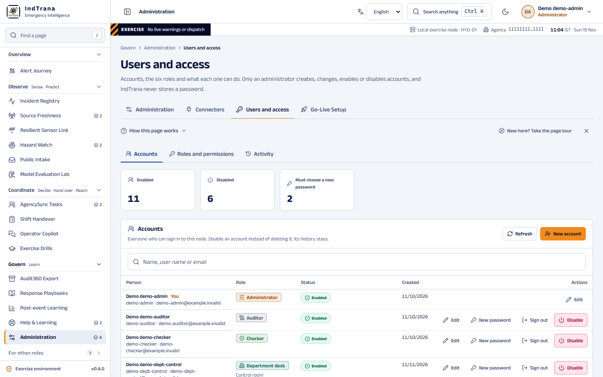
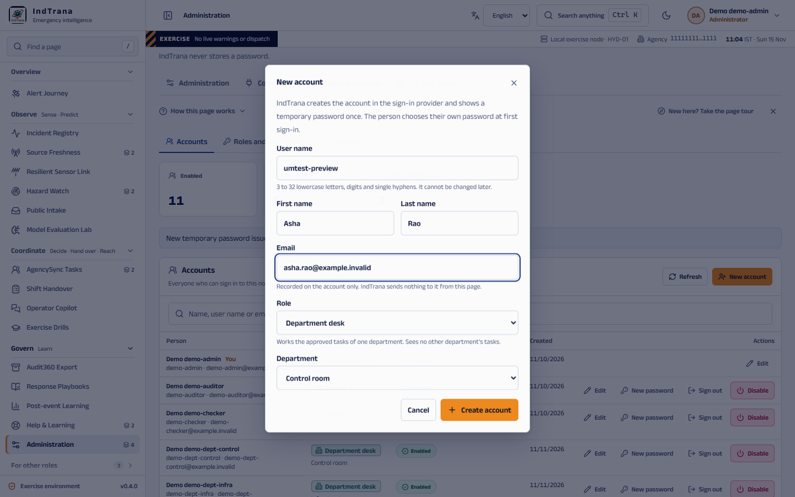
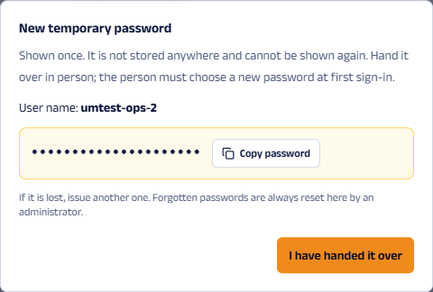

# User management

Administrators (`platform_admin`) manage sign-in accounts from **Users and access** (`/admin/users`), tabs
**Accounts**, **Roles and permissions** and **Activity**. Other roles see only the roles tab.

| New account form | Temporary password, shown once (masked here) |
| --- | --- |
|  |  |

## What it does

| Action | What happens in the sign-in provider |
| --- | --- |
| New account ("invite") | Account created with one role, a department (department desk only) or team (response team only), a verified email and a **temporary** password. |
| Edit | Name, email, role, department, team. Changing the role clears a department or team the new role does not use. |
| Disable | Account disabled **and** all its sessions ended. |
| Enable | Account can sign in again with its current password. |
| New password (reset and resend) | A new temporary password; the old one stops working and sessions end. |
| Sign out everywhere | All sessions of the account end. |

There is **no delete**. Disable an account instead; its history and audit rows stay.

## Passwords

- The identity provider stays the account store. IndTrana never stores or checks a password.
- Temporary passwords are generated on the server (`secrets`, 20 characters from 56 unambiguous letters and digits),
  set as temporary so the provider forces a new password at the next sign-in, returned **once** in the API answer
  with `Cache-Control: no-store`, shown once in a panel that only closes with "I have handed it over", and never
  logged, audited or stored.
- Nothing is sent by email, SMS or any other channel. The administrator hands the password over in person.
- **Forgot password**: the sign-in page tells the person to ask their administrator, who issues a new temporary
  password here. The provider's own self-service reset and its email (SMTP) stay off.

## Guards (enforced by the API; the page repeats them only for convenience)

- Every route is `scoped_operator(frozenset({"platform_admin"}))`: the exercise agency's administrator only.
- Exactly one role from the six known roles. A department is required for, and only for, `department_operator`
  (`control_room`, `infrastructure`, `communications`); a team is required for, and only for, `response_team`
  (ids from `services/api/app/fixtures/synthetic_teams.v1.json`).
- User names: 3 to 32 lowercase letters, digits and single hyphens, starting with a letter. Names starting with
  `exercise`, `service-account-` or `indtrana-` are refused. A user name cannot be changed later.
- Protected: the owner's `exercise-*` accounts are listed with a "Protected" mark and refuse every change. Every
  `service-account-*` account (including the service client's own) refuses every change too; the provider leaves
  service accounts out of its user list, so they do not appear on the page at all.
- An administrator cannot disable, demote, reset or sign out their own account here (name and email are allowed).
- The last enabled administrator cannot be disabled or given another role (protected accounts are not counted).
- Request bodies reject unknown fields and NUL characters; failures are fixed `user_admin_*` codes turned into
  sentences by `apiFailureText` in `apps/web/lib/labels.ts`. Upstream error text never reaches the browser.
- New accounts get the caller's agency: the web client signs one fixed agency (`signed-demo-agency` mapper) into
  every token of the realm, and the routes are limited to that exercise agency.

## Audit

`db/migrations/020_user_admin_audit.sql` adds the append-only `user_admin_audit` table (update, delete and truncate
are refused by triggers). One row per change: closed action code, outcome (`done` or `incomplete`), target account id
and user name, closed codes of the changed fields, the new role when it changed, the actor's subject and the time.
Never a password, never an email address.

Every change runs inside one database transaction that holds an advisory lock (changes run one at a time, so the
last-administrator check cannot race). The provider call runs inside it and the audit row is inserted only after the
call succeeded, so a failed call leaves no row. If the database fails after the provider call succeeded, the change
exists without a row; the API answers `user_admin_unavailable` and the list shows the real state. An interrupted
create leaves the account **disabled** and is recorded `incomplete`. A failed sign-out after disable or reset is
recorded `incomplete` (the account is still disabled, or the new password is still shown).

## Honest limits

- An access token already issued stays valid until it expires (at most 15 minutes) even after disable or sign-out.
  The provider refuses the next sign-in and token refresh at once.
- The list shows at most 200 accounts (the answer says when it was cut).
- Each listed account costs one role-mapping read in the provider (six in parallel); fine for an exercise realm.
- The email address is marked verified when an administrator sets it, as the demo script does. Staff email notices
  (docs/COMMUNICATION_CHANNELS.md) trust that flag, and still go only to people who opted in.
- macOS/Linux: `aegis.sh` does not run `update-local-idp.ps1` (not ported), so the service client is not created
  there and the Accounts tab shows "not switched on". Not tested on macOS or Linux.

## Known follow-ups

Raised by the security review (15 November 2026). The code is not changed yet.

- (a) If the database fails after the identity provider change has already succeeded, the audit row can be missing.
  If that happens during a password reset, the new temporary password is never shown.
- (b) An email address changed by an administrator is treated as verified.
- (c) A duplicate email address is reported as "user name taken".
- (d) The last-administrator guard reads only the first 200 accounts.

## Setup (Windows laptop)

1. With IndTrana running: `powershell -ExecutionPolicy Bypass -File .\scripts\update-local-idp.ps1`. Step 11 creates
   the confidential client `indtrana-user-admin` (service account only: no browser sign-in, no password grant, no
   device or CIBA grant, no redirect address). Its service account holds exactly the realm-management roles
   `view-users`, `query-users` and `manage-users`, and none of the realm's default roles. It needs no client-read
   right: the web client's internal id is learned from the signed-in administrator's own role mapping.
2. The step reads the client secret inside the provider container and writes it only to
   `%LOCALAPPDATA%\AEGIS\local-idp\user-admin.env` (`AEGIS_USER_ADMIN_CLIENT_SECRET=...`). It is never printed,
   committed or sent to the browser. `compose.local-idp.yaml` passes that file to the API as an optional env file
   and sets the fixed base URL `https://indtrana-idp.localhost:8443`, realm and client ids.
3. Restart: `aegis.cmd stop` then `aegis.cmd start`. Without the file every route answers `user_admin_not_configured`
   and the Accounts tab explains how to switch it on.

The API calls the provider only at that fixed HTTPS address, follows no redirects, uses no proxy, waits at most six
seconds per call and reads at most 2 MB per answer. It never uses the provider's bootstrap administrator.

## Code

- API: `services/api/app/user_admin.py` (routes and guards), `app/user_directory.py` (provider client and a test
  double), `app/user_admin_store.py` (audit store). Tests: `services/api/tests/test_user_admin.py`.
- Web: `apps/web/lib/user-admin-proxy.ts`, routes under `apps/web/app/api/user-admin/`, UI
  `apps/web/components/user-accounts.tsx` inside `components/users-access.tsx`. Tests:
  `apps/web/scripts/tests/user-admin-proxy.test.cjs`.
