# IndTrana: Technical and Architecture Documentation

**Exercise prototype — synthetic data — not a live warning system**

Version 0.3.0 · 14 November 2026 · Prepared by the IndTrana project

*This document describes a local demonstration prototype that uses synthetic exercise data. It carries no government emblem, approval or endorsement. This is the Markdown edition of the Word and PDF document of the same name; section and figure numbers match.*

## Contents

- [1 Summary](#1-summary)
- [2 The problem and the idea](#2-the-problem-and-the-idea)
  - [2.1 The six-step alert path](#21-the-six-step-alert-path)
  - [2.2 First demonstration and product modules](#22-first-demonstration-and-product-modules)
  - [2.3 Why it is designed this way](#23-why-it-is-designed-this-way)
- [3 Users and use cases](#3-users-and-use-cases)
  - [3.1 The six roles](#31-the-six-roles)
  - [3.2 How a proposal moves](#32-how-a-proposal-moves)
  - [3.3 Use cases](#33-use-cases)
- [4 Architecture](#4-architecture)
  - [4.1 System context](#41-system-context)
  - [4.2 Runtime architecture](#42-runtime-architecture)
  - [4.3 Sign-in and request flow](#43-sign-in-and-request-flow)
  - [4.4 Logical data model](#44-logical-data-model)
  - [4.5 Optional overlays](#45-optional-overlays)
  - [4.6 API route groups](#46-api-route-groups)
  - [4.7 Technology choices](#47-technology-choices)
  - [4.8 Repository layout](#48-repository-layout)
- [5 Security and governance](#5-security-and-governance)
  - [5.1 Identity and roles](#51-identity-and-roles)
  - [5.2 Agency scope and the sign-in gate](#52-agency-scope-and-the-sign-in-gate)
  - [5.3 Maker-checker and audit](#53-maker-checker-and-audit)
  - [5.4 Browser protections](#54-browser-protections)
  - [5.5 Limits placed on automation and assistants](#55-limits-placed-on-automation-and-assistants)
  - [5.6 Trust boundaries](#56-trust-boundaries)
  - [5.7 What the 14 November 2026 test did and found](#57-what-the-14-november-2026-test-did-and-found)
  - [5.8 Open items](#58-open-items)
- [6 Walkthrough of the application](#6-walkthrough-of-the-application)
- [7 Communication and the patented sensor-link idea](#7-communication-and-the-patented-sensor-link-idea)
  - [7.1 How IndTrana reaches people](#71-how-indtrana-reaches-people)
  - [7.2 Resilient Sensor Link](#72-resilient-sensor-link)
- [8 Deployment](#8-deployment)
  - [8.1 Today](#81-today)
  - [8.2 What a government deployment would still need](#82-what-a-government-deployment-would-still-need)
- [9 Status and limits](#9-status-and-limits)
  - [9.1 How to cite this submission](#91-how-to-cite-this-submission)
- [10 Testing and evidence](#10-testing-and-evidence)
- [11 Version history](#11-version-history)
- [12 Interactive edition and how to use it](#12-interactive-edition-and-how-to-use-it)
  - [12.1 The interactive page](#121-the-interactive-page)
  - [12.2 The Markdown edition](#122-the-markdown-edition)
- [Glossary](#glossary)
- [List of figures](#list-of-figures)
- [List of tables](#list-of-tables)

Document control

**Table 1.** Document control

| Item | Value |
| --- | --- |
| Title | IndTrana: Technical and Architecture Documentation |
| Product version | 0.3.0 |
| Date of this document | 14 November 2026 |
| Status of the product | Exercise prototype — synthetic data — not a live warning system |
| Prepared by | The IndTrana project |
| Source of every statement | The project repository: its README, the documents in docs/, the migrations, the Compose files and the code. |
| Companions | IndTrana-Overview-v0.3.0.html (interactive page that works offline), IndTrana-Technical-Architecture-v0.3.0.md with its assets folder (Markdown edition) and IndTrana-Technical-Architecture-v0.3.0.pdf. Section 12 describes them. |

How to read this document

Read Section 1 for a one-page summary. Sections 2 and 3 explain the idea and who uses the system for what. Section 4 is the architecture, Section 5 the security design and its test, Section 6 a page-by-page walkthrough with screenshots. Sections 7 and 8 cover the sensor-link idea and what a government deployment would still need. Section 9 states plainly what is and is not ready, and gives the citation details. Section 10 lists the test evidence, Section 11 the version history and Section 12 the interactive page and Markdown edition that accompany this document. Terms are defined where they first appear and again in the Glossary.

A note on names. The product is called IndTrana. It was renamed from AEGIS on 13 November 2026, and only the visible name changed. Technical identifiers keep the older prefix on purpose so that existing installs, sign-in and the database keep working: environment variables such as AEGIS_*, token claims such as aegis_roles, the Compose project ai-project-aegis, the aegis.cmd launcher, and file and script names. Where one appears in this document it is a technical identifier, not a second product.

## 1 Summary

**What it is.** IndTrana is a decision desk for disaster agencies: it gathers evidence, shows how fresh and how certain it is, and makes sure two different accountable officers approve a proposal before anything is handed to the official alerting authority.

**Who it is for.** Emergency operations centres, department desks and response teams of a disaster-management agency, and the people who audit them.

**What it does.** It gathers hazard evidence and shows how old each source is; correlates it with incidents on a map; drafts response proposals with cited evidence; and routes them through an independent two-person approval (a maker and a different checker). After approval it produces a private draft alert file in the standard Common Alerting Protocol (CAP) format and scripted department tasks, and it lets department desks and invented response teams rehearse the last step of the chain inside the application. Every step is written to an audit trail. Automation prepares and explains; people decide; the alerting authority issues.

**What it does not do.** It sends no public warning, dispatches no team and contacts no outside agency. It is not connected to any official data feed. Its data is synthetic. Its rehearsal statistics are not forecasting accuracy. It has no government approval or certification. Security testing so far is a developer self-assessment, not an independent audit.

**What is asked of the reader.** Read the architecture and the security design, look at the walkthrough, and judge whether the method (cited evidence, two accountable people, a full record) is worth carrying forward. Section 8 lists what a government deployment would still need; none of it is built.

**Version and status.** This is version 0.3.0 of a local demonstration prototype. The target government deployment is described only as a list of what would still be needed.

## 2 The problem and the idea

In disaster response a wrong or late warning costs trust and can cost lives. The evidence arrives from many sources, some stale or in conflict, and the decision to warn must rest on named, accountable people rather than on a model. IndTrana's mission, in the words of its vision document, is to turn verified weather, geospatial and incident observations into explainable, auditable, multi-agency emergency decisions, without claiming perfect prediction.

### 2.1 The six-step alert path

IndTrana organises everything around six steps: Sense, Predict, Decide, Hand over, Reach and Learn. Figure 1 shows, for each step, what software does, what a person decides, and where IndTrana stops. The boundary that matters most lies between Hand over and Reach: IndTrana prepares a draft, and a person gives it to the official alerting authority, whose own system reaches telephones.

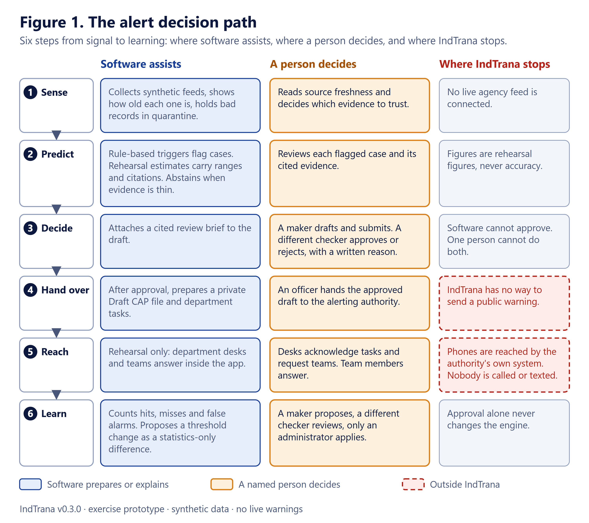

**Figure 1.** The alert decision path: where software assists, where a person decides and where IndTrana stops.

### 2.2 First demonstration and product modules

The first demonstration is a synthetic urban-flood exercise in Hyderabad: ingest synthetic rainfall and water-level readings with source and freshness metadata, calculate a demonstration-only index and flag uncertainty, show the incident and its geographic context, generate a proposed response with references to an approved playbook, require a separate checker, then simulate department acknowledgements and keep an audit timeline.

**Table 2.** Module names used in the project's vision document. Section 6 shows what exists as pages today.

| Module (vision-document name) | Function |
| --- | --- |
| GeoCommand | Map-based incident operations and exposure |
| DataFusion | Source adapters, provenance, quality and freshness |
| Sentinel Forecast | Versioned hazard estimates with calibration and uncertainty (rehearsal only here) |
| Incident Fusion | Deduplication, case lifecycle and evidence |
| Response Copilot | Citation-grounded procedure recommendations |
| ApprovalGuard | Maker-checker authorisation and immutable decisions |
| AgencySync | Department tasks, acknowledgements and rehearsal time targets |
| PolicyStudio | Versioned policy configuration and access constraints |
| ReplayLab | Deterministic synthetic incident simulations |
| Audit360 | Traceability and evidence export |

### 2.3 Why it is designed this way

**Table 3.** Main design decisions and their reasons

| Decision | Reason |
| --- | --- |
| Human maker-checker on every consequential step | Accountability must sit with two named people, not a model. |
| Server layer holds the tokens | Tokens never reach browser scripts, so a script-injection flaw cannot steal them. |
| Agency, role and department only from signed tokens | Anything the browser supplies can be forged; authority must come from the identity provider. |
| Cited evidence and abstention instead of free-text AI | Operators must be able to verify each claim; unsupported questions abstain. |
| Bounded, cancellable, draft-only automated runs | Automation gets a fixed step budget and stops before submission, so it helps without acting. |
| Optional features are off by default | New capabilities ship without changing the base system; each is opted into and reviewed. |
| PostGIS and immutable snapshots | Spatial checks need real geometry; an approval must refer to exactly what the checker saw. |
| Local-first, no paid infrastructure | It runs on one laptop for demonstrations and tabletop exercises with no cost and no data leaving the machine. |

## 3 Users and use cases

### 3.1 The six roles

Every person signs in as themselves, with a role and an agency assigned at the agency's identity provider. The role decides what the person can do (Figure 2); the server checks the role again on every request. A person with several roles is shown the menu of the role with most responsibility.

**Table 4.** The six roles

| Role | Summary (from the role matrix in the application) |
| --- | --- |
| Maker | Drafts and submits proposals, runs the hazard watch and starts drills. Cannot approve. |
| Checker | Approves or rejects what a different person submitted. Cannot draft or submit. |
| Auditor | Reads proposals, decisions and their audit trail. Cannot change anything. |
| Department desk | Works the approved tasks of one department. Sees no other department's tasks. |
| Response team | Answers requests for its own synthetic team inside IndTrana. Sees no other team's requests, proposals or audit. |
| Administrator | Sets up connectors and holds the kill switch. Cannot draft, submit or approve proposals. |

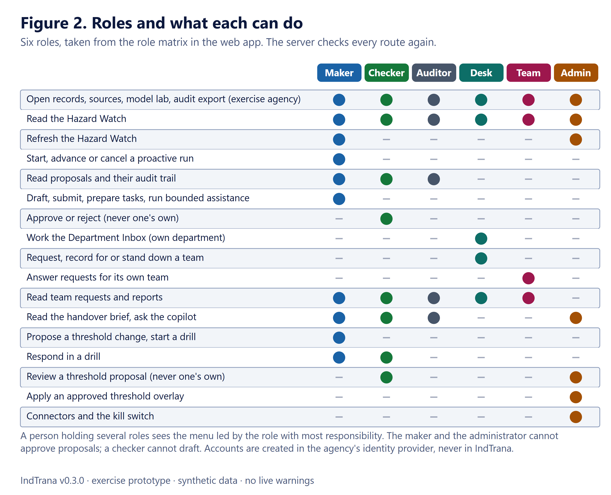

**Figure 2.** Roles and what each can do, from the role matrix in the web application.

Two further rules sit on top of the matrix. A department desk is tied to one department and a response team to one team by signed claims, never by a choice in the browser. And no role can both draft and approve: the maker cannot approve and the administrator cannot draft, submit or approve.

### 3.2 How a proposal moves

Figure 3 follows a proposal from draft to a closed task, with the role that performs each change. The two-key rule (a different checker) is enforced by the API and again by a database trigger. Team requests are a rehearsal inside the application: nobody is called, texted, emailed or radioed.

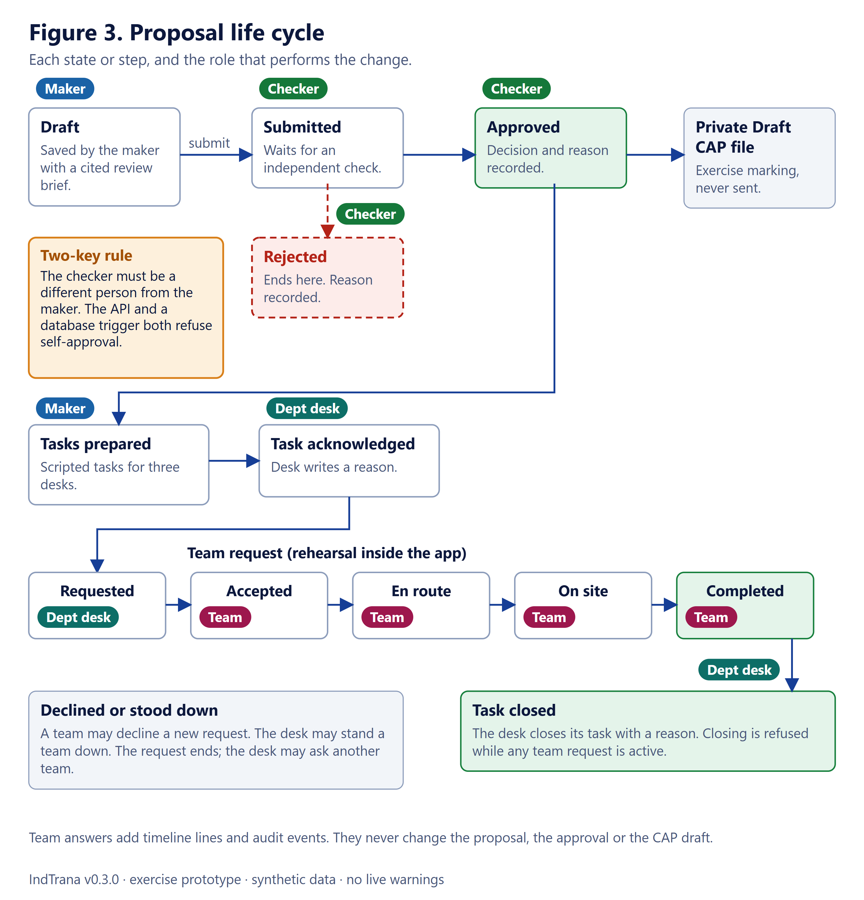

**Figure 3.** Proposal life cycle: states, steps and the role that performs each change.

Figure 4 shows the same states as a compact state diagram, including the team-request branch, drawn with Archify. It adds a second view of the same rules and no new rule; the roles are in Figure 3.

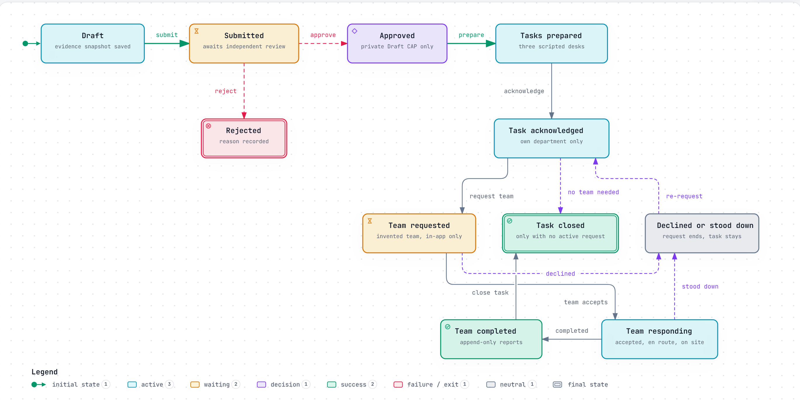

**Figure 4.** Proposal, task and team-request states (Archify state diagram, landscape page). The earlier figure, with the role for each step, is kept because it shows who performs each change.

### 3.3 Use cases

Each use case lists the actor, the goal, what must be true first, the main steps, what the system records and what never happens. UC-15 and UC-16 describe the guided tours and the What's new page, which are part of version 0.3.0.

#### UC-01 Sign in

| Item | Detail |
| --- | --- |
| Actor | Any person with an account at the agency identity provider |
| Goal | Obtain a verified session with the correct agency and role. |
| Preconditions | An account exists at the identity provider, with an agency and at least one role assigned there. |
| Main steps | 1. Open the site and choose Sign in, then Continue to sign in. 2. Enter user name, password and second factor on the identity provider's own page. 3. Return to IndTrana, which checks the provider's signature and opens a 15-minute session. |
| What is recorded | A sealed session cookie in the browser. The provider keeps its own sign-in log. IndTrana stores no password. |
| What never happens | IndTrana never sees a password. Role and agency are never taken from the browser. There is no sign-in without the provider. |

#### UC-02 Watch sources and their freshness

| Item | Detail |
| --- | --- |
| Actor | Any signed-in role |
| Goal | Know which data feeds are late, missing or odd before relying on them. |
| Preconditions | Signed in as a member of the exercise agency. |
| Main steps | 1. Open Source Freshness and filter by state. 2. Open a feed to see its recent history. 3. Open DataFusion Replay to see what was accepted, repeated or quarantined. |
| What is recorded | Nothing is written; these pages are read-only. |
| What never happens | It never contacts a real agency feed. Agreement between feeds is not proof that they are right. Quarantined records are never released from this page. |

#### UC-03 Review an incident

| Item | Detail |
| --- | --- |
| Actor | Maker (any reader role may read) |
| Goal | Understand one exercise case: evidence, readiness, unknowns and any team response. |
| Preconditions | A synthetic incident exists in the agency. |
| Main steps | 1. Search, sort and filter the Incident Registry. 2. Open a case; read its evidence, the readiness checks and the explicit unknowns. 3. Use the spatial explorer (1, 3 or 5 km) to see nearby candidate sources; read the Team response panel and timeline. |
| What is recorded | Nothing is written. |
| What never happens | It never creates or changes a case. It never computes a real flood-risk score. Nearby is a candidate, never proof of cause. |

#### UC-04 Draft a proposal

| Item | Detail |
| --- | --- |
| Actor | Maker |
| Goal | Prepare a cited proposal (for example a warning draft) for independent review. |
| Preconditions | A case in the maker's agency; the maker holds the incident_operator role. |
| Main steps | 1. Open the Approval Workbench and choose the incident and the action type. 2. Write the rationale. Save the draft; the cited review brief is captured with it. 3. Optionally run a bounded assistance run (fixed step budget, stops before submission) and simulate. 4. Submit for independent review. |
| What is recorded | The proposal with an immutable snapshot of the evidence and citations, and audit events written in the same transaction. An opted-in checker may get a fixed-text email notice. |
| What never happens | It never sends anything. The maker cannot approve. Text typed by a client is never accepted as model output. |

#### UC-05 Independent approval or rejection

| Item | Detail |
| --- | --- |
| Actor | Checker |
| Goal | Decide, with a written reason, on a proposal drafted by someone else. |
| Preconditions | A submitted proposal whose maker is a different person. |
| Main steps | 1. Open the Approval Workbench and the submitted proposal. 2. Read the cited evidence and rationale. 3. Write a reason and approve or reject. |
| What is recorded | An approval row (checker, decision, reason, time) and an audit event, in one transaction. |
| What never happens | Self-approval is refused by the API and by a database trigger. Approval sends no warning: it only allows a private Draft CAP file and department tasks. |

#### UC-06 Department acknowledges and closes tasks

| Item | Detail |
| --- | --- |
| Actor | Department desk |
| Goal | Work the approved tasks of one department. |
| Preconditions | An approved proposal whose scripted tasks the maker has prepared. The desk's account carries a department claim. |
| Main steps | 1. Open the Department Inbox; it lists only this department's tasks. 2. Acknowledge a task with a short reason. 3. When no team request is active, close the task with a reason. |
| What is recorded | Task state changes and audit events marked with department authority. |
| What never happens | It never shows another department's tasks. Time targets are rehearsal targets, not contractual. Closing is refused while a team request is active. |

#### UC-07 A desk requests a team and the team responds

| Item | Detail |
| --- | --- |
| Actor | Department desk and Response team |
| Goal | Rehearse the last step of the chain inside the app. |
| Preconditions | An acknowledged task on an approved proposal; invented teams exist in the fixture. |
| Main steps | 1. The desk opens Request a team and reads why each team is suggested (matching capability, free capacity, availability, estimated travel time). 2. The desk requests one team. 3. On a phone-sized view the team sees the request on My Team and presses Accept, I am en route, I am on site, Completed; it may send a situation report or ask for support. 4. The desk can record an answer on a team's behalf, stand the team down or mark a support flag handled. |
| What is recorded | Request and report rows, fixed-template timeline lines starting with SIMULATION, and audit events. |
| What never happens | Nobody is called, texted, emailed or radioed. Software never creates a request. Notes never reach the timeline. Teams are invented, not real units. |

#### UC-08 Shift handover

| Item | Detail |
| --- | --- |
| Actor | Maker, checker, auditor or administrator |
| Goal | Brief the next shift on what changed. |
| Preconditions | Signed in with a reading role. |
| Main steps | 1. Open Shift Handover and choose a window of 1 to 72 hours. 2. Read the brief; each line cites record identifiers. 3. Download or print it. |
| What is recorded | Nothing is written or saved. |
| What never happens | It is not a forecast, an approval or a dispatch. Reasons, rationales and proposal bodies are never copied into it. |

#### UC-09 Ask the operator copilot

| Item | Detail |
| --- | --- |
| Actor | Maker, checker, auditor or administrator |
| Goal | Get a quick, cited answer about the agency's records. |
| Preconditions | Signed in with a reading role. |
| Main steps | 1. Type a question of 3 to 300 characters or pick an example. 2. The question is mapped to one fixed intent, or the copilot abstains. 3. Read the answer and the records it cites. |
| What is recorded | Nothing is written. |
| What never happens | It cannot act, approve, notify or forecast, and it ignores instructions typed into a question. Unknown questions abstain. |

#### UC-10 Run a drill

| Item | Detail |
| --- | --- |
| Actor | Maker starts; maker and checker respond |
| Goal | Practise the chain on a simulated clock. |
| Preconditions | The proactive watch is on and not paused. |
| Main steps | 1. The maker starts a drill from a fixed scenario. 2. The clock moves only when someone advances it. 3. Makers and checkers respond to the injected evidence; the coach report compares elapsed minutes with rehearsal targets. |
| What is recorded | Drill state and drill audit rows. Injected evidence lives only inside the drill. |
| What never happens | No real record, proposal, task or message is created. The kill switch blocks new drill writes. Scores are rehearsal targets, not contractual. |

#### UC-11 Post-event learning and a threshold proposal

| Item | Detail |
| --- | --- |
| Actor | Maker, a different checker or administrator, and an administrator |
| Goal | Compare earlier triggers with what happened and propose a change to a threshold. |
| Preconditions | A closed event window. |
| Main steps | 1. The maker closes or replays a window and reads the statistics, labelled by basis. 2. The maker proposes a threshold change; a different checker or administrator reviews it. 3. Only an administrator can apply an approved change, creating a new versioned overlay. |
| What is recorded | Windows, proposals, versioned configuration and a learning audit. |
| What never happens | The statistics are never accuracy. Approval alone never changes the engine. Applying is blocked while the kill switch is engaged. |

#### UC-12 Administer connectors and the kill switch

| Item | Detail |
| --- | --- |
| Actor | Administrator of the exercise agency |
| Goal | Set up optional data sources and stop automation at once if needed. |
| Preconditions | The proactive overlay is on and a connector key is set. |
| Main steps | 1. Open Administration, Connectors; enter keys (write-only) and test them. 2. Switch a connector on; for email, also needs the host switch. 3. Engage or release the kill switch. |
| What is recorded | Connector audit and pause audit rows. |
| What never happens | A saved secret is never shown again. A test sends no message. SMS, WhatsApp and authority notification cannot be enabled. |

#### UC-13 Brand settings

| Item | Detail |
| --- | --- |
| Actor | Administrator |
| Goal | Change the name and logo people see in the browser. |
| Preconditions | Signed in as an administrator. |
| Main steps | 1. Open Administration, Brand. 2. Set a name or upload a PNG, JPEG or WebP logo of at most 256 KB; or restore the defaults. |
| What is recorded | Brand settings with a version check and an append-only brand audit (never the logo bytes). |
| What never happens | The configured name never reaches staff email, alert drafts, exports or audit text. SVG, GIF and ICO logos are refused. |

#### UC-14 Rehearse the sensor link

| Item | Detail |
| --- | --- |
| Actor | Any signed-in role |
| Goal | See how sensor readings could keep flowing when the ground network fails. |
| Preconditions | Signed in. |
| Main steps | 1. Open Resilient Sensor Link and step through the five-moment storm timeline. 2. Or pick a link scenario yourself and switch on the trigger-near option. 3. Read what stays possible: life-safety sensors reporting, feeds held, and whether control room, desks and teams have a link. |
| What is recorded | Nothing: it runs in the browser only. |
| What never happens | Nothing is transmitted and no satellite or radio link is used. Values are synthetic. |

#### UC-15 Take the onboarding tour

| Item | Detail |
| --- | --- |
| Actor | Any signed-in role |
| Goal | Learn the screen quickly, with steps matching the signed-in role. |
| Preconditions | Signed in. The Welcome tour starts by itself once per browser after sign-in; the other tours are started on request. |
| Main steps | 1. Follow the 8-step Welcome tour (the menu, Find a page, Search anything, Language, theme, the EXERCISE strip, your account, How this page works); use Next, Back, Skip tour or Escape. 2. For any page or tab, choose Tour this page in the account menu, or the Take the tour button beside How this page works. Steps are filtered by the signed-in role. 3. Optionally choose Tour all my pages to walk through every page the role can open, Restart welcome tour, or Show tour hints. |
| What is recorded | Only flags in one browser storage key (which tours were finished or skipped, whether hints are on, where an all-pages tour stopped, which release was last seen). No identity, role, token or case data. |
| What never happens | A tour changes no record and never submits anything: Next only moves the highlight. It is keyboard operable and respects reduced motion. Flags are per browser, not per account. |

#### UC-16 Read the release notes

| Item | Detail |
| --- | --- |
| Actor | Any signed-in role |
| Goal | See what changed in each version. |
| Preconditions | Signed in. |
| Main steps | 1. Open What's new from the account menu (it carries a New marker until the current version has been opened) or from the version number in the sidebar footer. 2. Read the notes for each version, newest first, grouped as New, Improved, Fixed and Security. The repository also keeps a CHANGELOG.md in developer wording. |
| What is recorded | Only a browser flag recording which version was last looked at. |
| What never happens | It changes no record. 0.3.0 is the first tagged release; the 0.2.0 and 0.1.0 entries are summaries of earlier work with a period instead of a date. |

## 4 Architecture

### 4.1 System context

Figure 5 shows who uses IndTrana and what it talks to. Six kinds of people use it through a browser. The organisation's identity provider signs them in. Public reference data and an email provider are optional and off by default. Public warning channels and outside agencies are drawn as not connected because IndTrana has no code that sends to them.

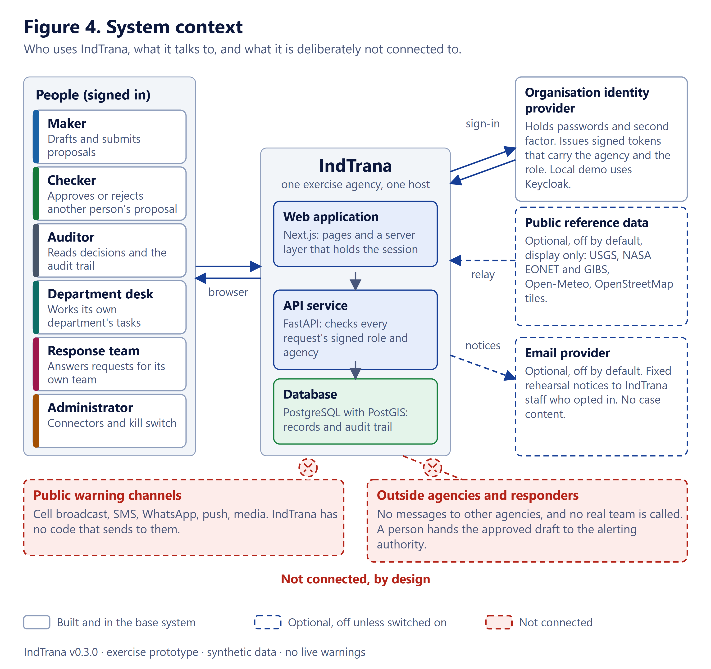

**Figure 5.** System context: users, identity provider, optional connections and what is deliberately not connected.

### 4.2 Runtime architecture

Figure 6 shows what runs on one host under Docker Compose. The browser talks only to the web application. The web application is also the browser's server layer (a backend for the browser): it holds the sealed session, checks the origin of every write, filters fields and forwards the person's token to the API. The API verifies the token, applies the role list of the route and the agency scope, and is the only program that reaches the database. The database publishes no host port.

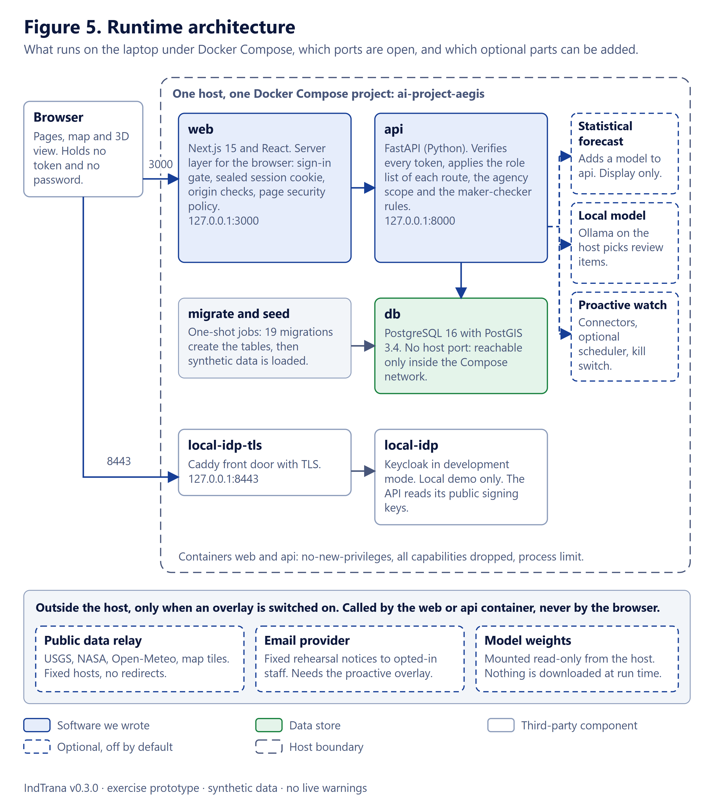

**Figure 6.** Runtime architecture under Docker Compose, with ports and optional overlays.

**Table 5.** Containers and published ports. Everything listens on the loopback address only.

| Container | Role | Host port | Notes |
| --- | --- | --- | --- |
| web | Next.js 15 web application and server layer | 127.0.0.1:3000 (configurable) | Memory limit 1 GB; no-new-privileges; all capabilities dropped; process limit |
| api | FastAPI service | 127.0.0.1:8000 (configurable) | Memory limit 512 MB; same hardening |
| db | PostgreSQL 16 with PostGIS 3.4 | None (internal only) | Memory limit 1 GB; one named volume |
| migrate, seed | One-shot jobs | None | Apply the schema and 19 migrations, then synthetic data; safe to repeat |
| local-idp, local-idp-tls | Keycloak and a Caddy TLS front door (demonstration only) | 127.0.0.1:8443 | Never moved to another port; development mode (finding M3) |

Figure 7 is a simpler second view of the same runtime, drawn with Archify. Figure 6 is kept as the reference because it also shows the optional overlays and the hardening of each container; the new view is easier to read as a first picture of the request path and the part that only the server side can reach.

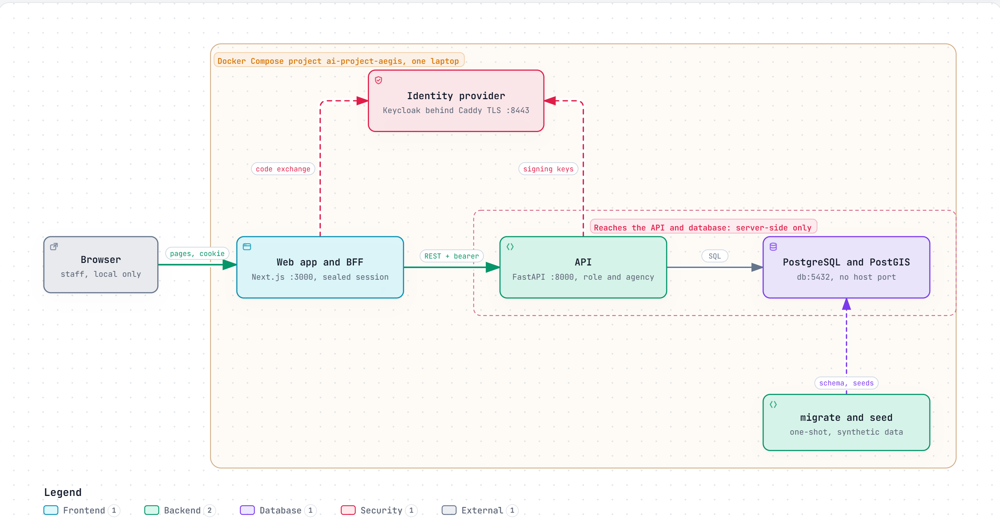

**Figure 7.** Runtime architecture, request-path view (Archify, landscape page). It supplements Figure 6, which reads better as the detailed reference.

### 4.3 Sign-in and request flow

Figure 8 follows one person from an anonymous browser to a recorded change. Sign-in uses the OIDC authorization-code flow with PKCE: the person types the password only at the identity provider, and IndTrana receives a one-time code, exchanges it on the server and seals the result into an encrypted HttpOnly session cookie that lasts 15 minutes. On every later request the web layer checks the cookie and the origin, then forwards the bearer token to the API server-side; the API verifies the signature and reads the agency and role only from the signed claims, checks the route's role list and the agency, and writes the change and its audit record in one transaction.

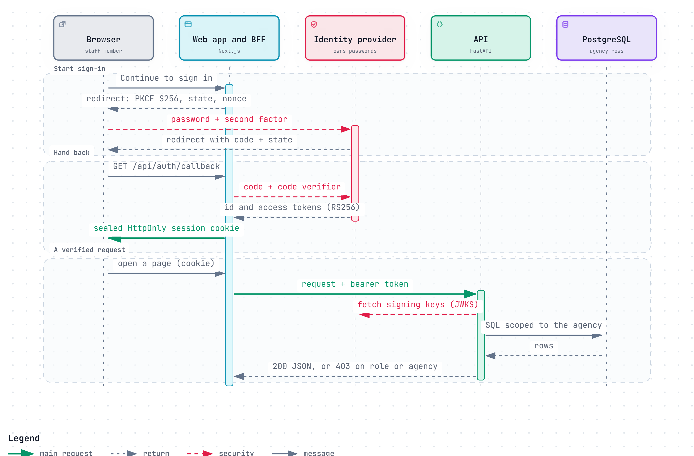

**Figure 8.** Sign-in and request sequence: the sign-in dance with the identity provider, the hand-back of the sealed session, and a verified request (Archify sequence diagram, on a landscape page; it replaces the earlier eleven-step flow figure).

### 4.4 Logical data model

Figure 9 groups the tables created by the schema and 19 migrations. Proposals, approvals and audit sit at the centre; the department tasks of a proposal are kept as a versioned receipt inside the proposal record and its audit, while the AgencySync tables hold a separate scripted fixture. Team requests and their append-only reports refer to proposals and incidents. Public intake is isolated and never links to cases. Connector secrets are stored encrypted.

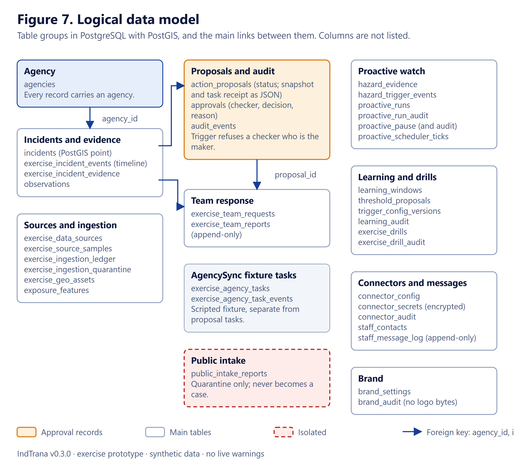

**Figure 9.** Logical data model: table groups and the main links between them.

Figure 10 is an entity-relationship diagram of 25 of these tables with primary keys, foreign keys and a few key columns each. It is drawn from the migrations; it does not list every column. It is dense, so it sits on its own landscape page: zoom the PDF or open the image in the Markdown edition for detail. Figure 9 is the version to read first.

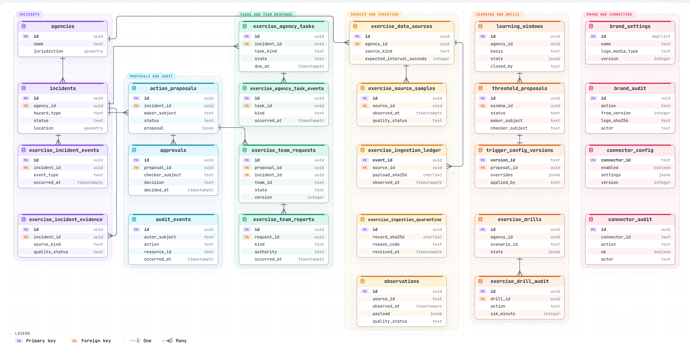

**Figure 10.** Entity-relationship diagram: 25 tables in six groups with key columns (Archify, landscape page; not every column is shown).

### 4.5 Optional overlays

Each optional capability is a separate Compose file with its own switch and is off by default (Table 6). None changes the base system; the base system stays model-disabled and send-disabled.

**Table 6.** Optional overlays and their switches

| Overlay | File | Switch | What it does |
| --- | --- | --- | --- |
| Local sign-in provider | compose.local-idp.yaml | -SignIn | A stand-in identity provider for the demonstration. |
| Public Earth reference feeds | compose.public-earth.yaml | -PublicEarth | Display-only USGS, NASA and Open-Meteo data through a server relay. Never written to the database. |
| Proactive watch | compose.proactive.yaml | -Proactive | Hazard watch, connectors with an encrypted vault, kill switch. Needs a connector key. |
| Watch scheduler | compose.proactive-scheduler.yaml | -ProactiveScheduler | Loop inside the API that prepares and routes, then stops before hand-over. |
| Staff email notices | compose.staff-email.yaml | -StaffEmail (with -Proactive) | Fixed rehearsal notices to opted-in staff; also needs the email connector enabled. |
| Statistical forecast | compose.timesfm.yaml | -StatisticalForecast | Display-only TimesFM 2.5 estimate; weights mounted read-only. |
| Local model review focus | compose.local-copilot.yaml | -LocalCopilot | A local model selects existing cited review items; falls back to a template. |
| Public intake | compose.public-intake.yaml | -PublicIntake | Quarantine-only citizen report intake; reports never become cases. |

### 4.6 API route groups

The API is a single FastAPI service (a modular monolith). Its routers cover the exercise workflow (incidents, proposals, approvals, tasks), department tasks, the team response loop, Earth Watch, public intake, proactive connectors, staff messages, brand settings, the proactive watch, runs and scheduler, the shift handover, the operator copilot, the statistical forecast, post-event learning and drills. Every data route needs a verified operator, an explicit role list and, for stored records, the exercise-agency check. Only the health check, a readiness check, a refusal stub for public warnings and the public brand read answer without a token, plus the opt-in public intake submission under its own rules. A test walks the route table and fails on any other route without the operator dependency.

### 4.7 Technology choices

**Table 7.** Technology choices and reasons

| Layer | Choice | Why |
| --- | --- | --- |
| Web application | Next.js 15, React, TypeScript, Tailwind, MapLibre | One framework for pages and for the server layer that holds sessions; maps run in the browser without a third-party host. |
| API | FastAPI (Python), Pydantic validation | Strict request models, one rule set for roles and agency, easy to test. |
| Database | PostgreSQL 16 with PostGIS 3.4 | Real geometry for spatial checks, transactions and triggers for approvals. |
| Sign-in | OIDC authorization code with PKCE; RS256 tokens; sealed session (A256GCM) | Authority comes from signed claims at the agency's own provider, never from the browser. |
| Local provider | Keycloak behind a Caddy TLS front door | A stand-in provider for the demonstration only. |
| Packaging | Docker Compose, one project, optional overlay files | One command per system; each new capability is opt-in and default off. |
| Tests | pytest for the API, Node tests for the web layer, headless browser checks | Scripted checks run on the Windows laptop. |

### 4.8 Repository layout

Figure 11 shows where the pieces described above live in the repository: the web application, the API service, the database schema and seeds, the documents, the scripts and the one-step launchers.

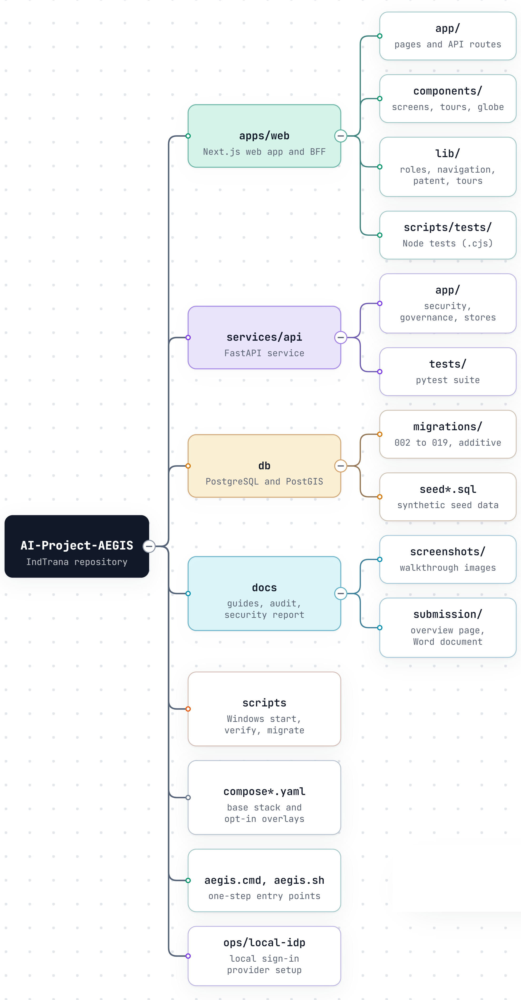

**Figure 11.** Repository layout (Archify tree). The image is tall, so it is scaled to fit one page and is narrower than the text width.

## 5 Security and governance

### 5.1 Identity and roles

IndTrana accepts only signed RS256 access tokens issued by the configured HTTPS identity provider. Every protected request validates issuer, audience, signature, expiry, issued-at and subject, with signing keys fetched from the provider's key endpoint. The token must carry the claims in Table 8; request bodies can never assert or override an actor, an agency or a role. If the provider is not configured, protected routes answer 503 instead of allowing a pretend identity.

**Table 8.** Claims the API requires (names keep the aegis prefix; see How to read this document)

| Claim | Meaning | Requirement |
| --- | --- | --- |
| iss, aud | Issuer and audience | Must equal the configured issuer; the audience must include the API's own |
| sub | Stable opaque identifier of the person | Non-empty, at most 256 characters |
| iat, exp | Issued-at and expiry | Current and not expired |
| aegis_agency_id | The person's agency (a UUID) | Assigned at the provider, never by the browser |
| aegis_roles | A list of known roles | Only the six known roles; anything else is refused |
| aegis_department_id, aegis_team_id | Department or team scope | Required for a department desk or a response team; a team must be one of the known team identifiers |

The identity provider must assign roles from administrator-controlled groups, and must not let users edit their own role or agency claims. Multi-factor sign-in, password rules and lock-out are the provider's job: IndTrana cannot enforce or detect them.

### 5.2 Agency scope and the sign-in gate

The web layer keeps every page and route behind a valid session except the landing page, the welcome and sign-in pages, the sign-in endpoints and the public brand read (name and logo only). The seeded exercise records are served only to people of the agency that owns them; others receive a styled refusal with no data. The gate is deliberately coarse: each route and the API check the session and role again. The page to return to after sign-in must be a plain in-app path and travels only in the sealed flow cookie, so there is no open redirect.

### 5.3 Maker-checker and audit

A proposal moves through draft, submitted, approved or rejected in a transaction that locks the row. A database trigger refuses a checker who is the maker, and a unique index allows one approval per proposal. The decision, the reason and the audit event commit together. The checker sees an immutable snapshot of what the maker captured. The same two-person pattern applies to threshold changes after an event. One limit is recorded in the security report: independence is judged on the subject of one pinned identity provider, so a second provider would need the issuer added to the comparison.

### 5.4 Browser protections

- A Content Security Policy with a per-request nonce: scripts need the nonce, there is no unsafe-inline or unsafe-eval for scripts in production, and connections and images are limited to this site. The style policy still allows inline styles (a recorded weakness).
- Frames are refused; HSTS, no-sniff, referrer and permissions policies are set; replies that carry data are not cached.
- Maps and public data load through a server relay with a fixed host and path list, no redirects, size and type limits and a rate limit, so the browser contacts no third-party host.
- Text from public feeds is escaped; links are drawn only for plain https addresses.
- Optional unsaved-text recovery uses session storage scoped to the verified person and agency, with expiry; it never stores credentials and never submits by itself.

### 5.5 Limits placed on automation and assistants

- **Bounded runs.** A proactive run has a fixed step budget, retry protection and a hard stop before submission; the scheduler stops before hand-over.
- **Copilot and guide.** Questions are untrusted input, mapped to one fixed intent or an abstention; tools are read-only, take only code-extracted identifiers and never write, approve, notify or dispatch.
- **Optional local model.** It may only rephrase cited facts or pick existing review items; it falls back to a template if it cites an unknown record.
- **Public data.** Display-only, never written to the database and never able to create or enrich cases, proposals, tasks or alerts.
- **Email.** One fixed-text channel to opted-in staff: fixed templates with no case content, address taken only from the verified token, per-person and per-agency caps, two switches, logged without addresses. SMS, WhatsApp, push and authority notification cannot be enabled.

### 5.6 Trust boundaries

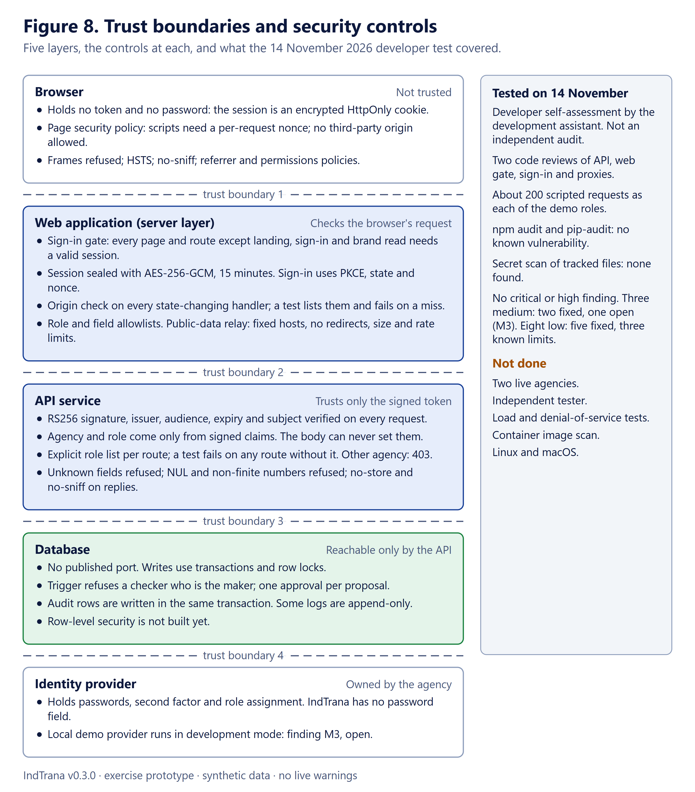

**Figure 12.** Trust boundaries and the controls at each layer, with the 14 November test summary.

### 5.7 What the 14 November 2026 test did and found

The test was a developer self-assessment carried out by the development assistant on the signed-in product with the eight local demo accounts. It is not an independent penetration test and does not replace the audit that government hosting requires. All eight accounts belong to one exercise agency, so isolation between two real agencies was checked in code and automated tests, not with two live agencies.

**Table 9.** Tests carried out on 14 November 2026

| Test | Method | Result |
| --- | --- | --- |
| Code review, pass 1 | White-box read of API authorisation, web gate, sign-in, proxies, outbound calls, upload, scripts and Compose files | 2 medium, 4 low, 2 informational |
| Code review, pass 2 | Every API route taking an id (93 listed, 47 traced), 29 request models, every HTML sink, all 27 state-changing web handlers | 1 medium, 3 low, 1 informational |
| Dynamic test, signed in | About 200 scripted requests and browser checks as each demo role | 2 low, 1 informational; everything else held |
| Dependencies | npm audit and pip-audit | No known vulnerability |
| Secrets in tracked files | Pattern scan | None found |
| Review of the fixes | Two independent read-only reviews | No blocking finding |

What held: signed-out access was refused except for the intended public pages; forged and malformed tokens were refused with 401; no token reached the browser; a changed cookie was refused; wrong sign-in state was refused and no open redirect was found; each role's replays of other roles' requests, a maker approving their own proposal and a desk acting on another department's task were refused; foreign-origin writes were refused with 403; stored script text did not execute; assistant questions asking it to ignore the rules abstained; logo uploads of the wrong kind were refused; and only web, API and the sign-in provider listen, on the loopback address.

**Table 10.** Findings of the 14 November test and their status

| Id | Severity | Finding | Status |
| --- | --- | --- | --- |
| M1 | Medium | One web route that computes a synthetic index had no same-origin check | Fixed and re-tested; a test now lists every state-changing handler |
| M2 | Medium | Platform-wide administration accepted an administrator from any agency | Fixed and re-tested; limited to the exercise agency's administrator |
| M3 | Medium | Local sign-in provider runs in development mode with its console behind the same front door | Open: deployment prerequisite (harmless on the laptop; port is 127.0.0.1 only) |
| L1 | Low | Three public-feed values shown without escaping on one card | Fixed and tested |
| L2 | Low | API replies carried no defensive headers | Fixed: nosniff on every reply, no-store unless the route sets its own |
| L3 | Low | Risk input ignored unknown fields; NaN or Infinity caused a server error | Fixed: unknown fields refused, non-finite numbers get 422 |
| L4 | Low | Connector updates had no key-count limit and echoed unknown key names | Fixed: at most 32 keys; echo only plain identifiers |
| L5 | Low | A NUL character in a rationale caused a server error | Fixed: validation reply and a plain sentence on the page |
| L6 | Low | A copied session cookie works until expiry (at most 15 minutes) after sign-out | Known limit: needs a server-side session list |
| L7 | Low | Provider admin password passed as an argument inside the container by scripts | Known limit, local only |
| L8 | Low | Fallback database password, partial container hardening, no per-session relay limit | Known limit: to be closed in hosting work |

Not done: a test with two live agencies or a person holding both maker and checker roles; a sign-in brute-force run; load and denial-of-service tests; a container image scan; an independent tester; any test on Linux or macOS.

### 5.8 Open items

- Row-level security in the database and dedicated database roles (first item after the demonstration).
- A real identity provider with a server-side session list; the development-mode provider console (M3) must not be reachable in any shared use.
- An independent security audit; no security claim in this document replaces one.
- Native-speaker review of Telugu and Hindi text.

## 6 Walkthrough of the application

This section follows the order a presenter would use: the public page, sign-in, the Command Center and the pages grouped in the menu as Observe, Coordinate and Govern. Each screenshot was captured on 14 November 2026 from the running application on the Windows laptop, at 1440 by 900 pixels unless marked as a phone view, and none is cropped. All data shown is synthetic. For each page: what you are looking at, how it is used, and what it never does.

The menu groups pages by step of the alert path: Overview; Observe (Sense and Predict); Coordinate (Decide, Hand over and Reach); Govern (Learn). Every page has a How this page works block with the same three parts used below.

#### 6.1 Landing page (public)

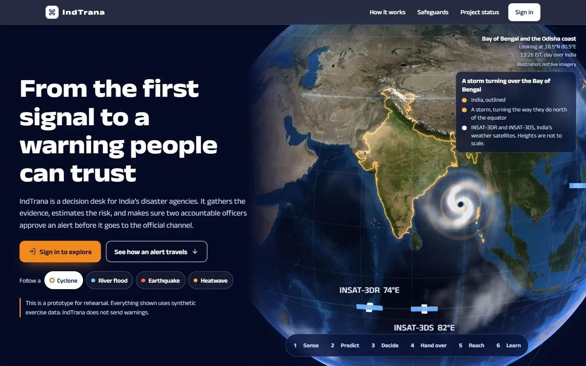

*Screenshot.* Landing page (public). Address: `/`. Captured 14 November 2026.

**What you are looking at.** India seen from its own weather satellites, a hazard picker (cyclone, river flood, earthquake, heatwave), and the six steps an alert takes. This is the only public page besides sign-in.

**How it is used.** A visitor reads what IndTrana is, picks a hazard to fly the globe to the matching region, and chooses Sign in.

**What it never does.** It shows no live data and makes no claim of forecasting capability. The page states it is a prototype for rehearsal.

#### 6.2 Sign-in page

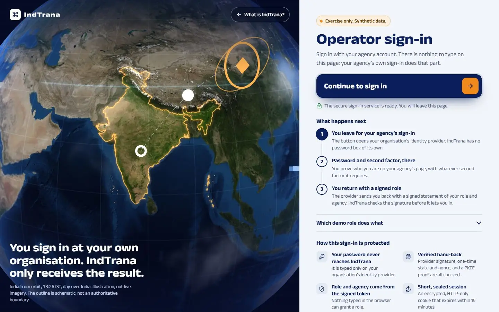

*Screenshot.* Sign-in page. Address: `/sign-in`. Captured 14 November 2026.

**What you are looking at.** Three steps: leave for your identity provider, enter your password and second factor there, return with a signed role.

**How it is used.** Press Continue to sign in.

**What it never does.** There is no password box in IndTrana. A failed hand-back returns here with a plain message.

#### 6.3 The provider's own sign-in form

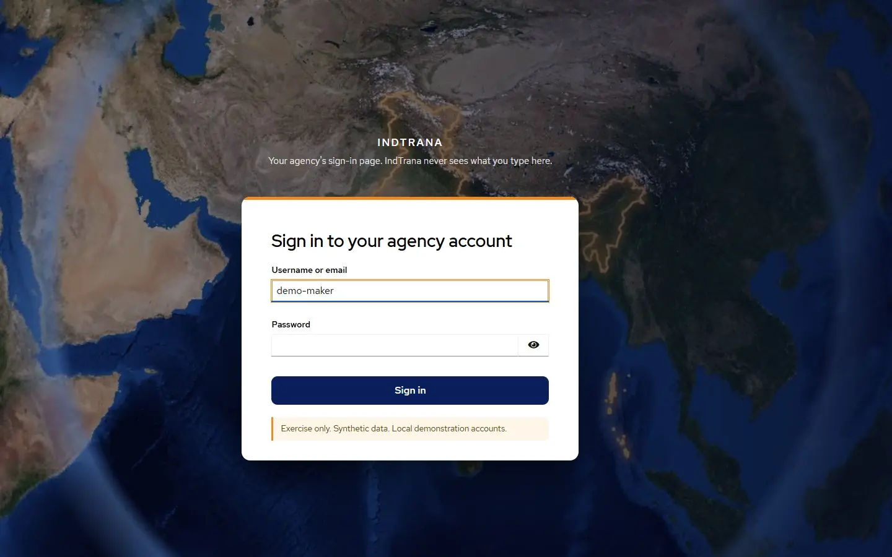

*Screenshot.* The provider's own sign-in form. Address: provider on port 8443. Captured 14 November 2026.

**What you are looking at.** The identity provider's page, in the same look. In the demo this is the local Keycloak.

**How it is used.** Type the user name and password; the provider checks them and returns the browser to IndTrana with a signed sign-in result.

**What it never does.** IndTrana never receives the password.

#### 6.4 Command Center

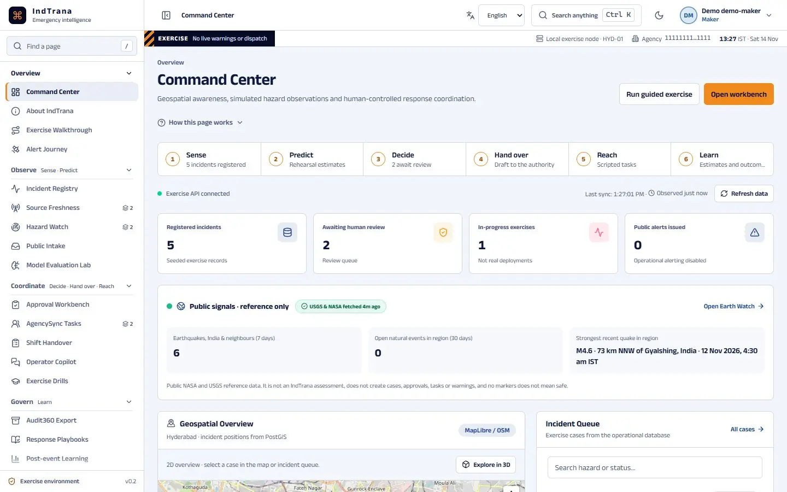

*Screenshot.* Command Center. Address: `/`. Captured 14 November 2026.

**What you are looking at.** The exercise incidents on a map and in a queue, the six-step chain with counts, public reference signals, source freshness and the workload of each desk. The orange EXERCISE strip is always visible.

**How it is used.** Pick an incident to read its evidence, switch the map between 2D and schematic 3D, and open any case in the registry.

**What it never does.** It never sends a warning, dispatches anyone or shows live operations. Map locators are symbols, not flood extent or severity.

#### 6.5 Welcome tour

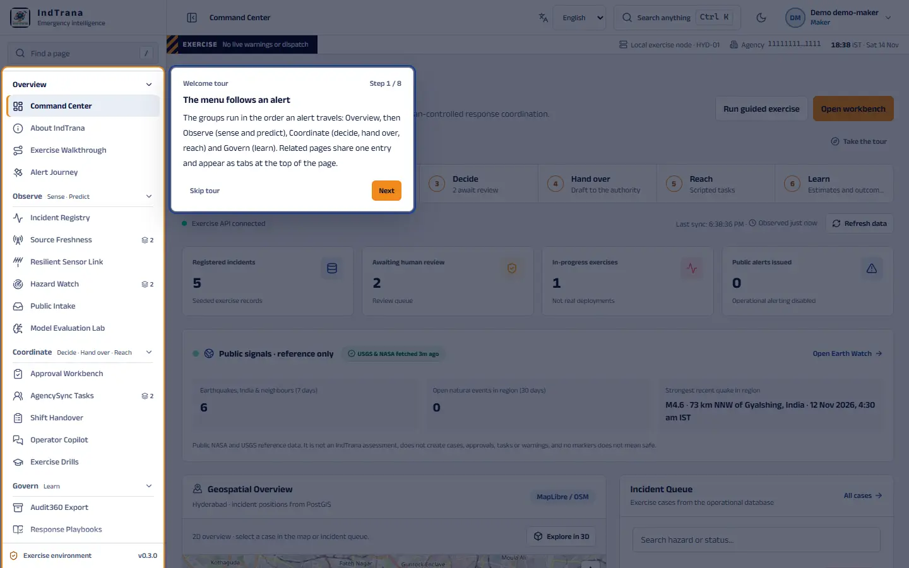

*Screenshot.* Welcome tour. Address: / (first step). Captured 14 November 2026.

**What you are looking at.** The first of eight steps of the Welcome tour, shown as a card over the Command Center with the menu highlighted. The eight steps cover the menu, Find a page, Search anything, Language, the theme switch, the EXERCISE strip, your account and the How this page works block.

**How it is used.** The tour starts by itself once per browser after sign-in. Use Next and Back, or Skip tour or Escape to leave; it can be restarted from the account menu.

**What it never does.** It stores only non-identifying flags in the browser, changes no record and is never needed to use a page.

#### 6.6 Account menu with tours and What's new

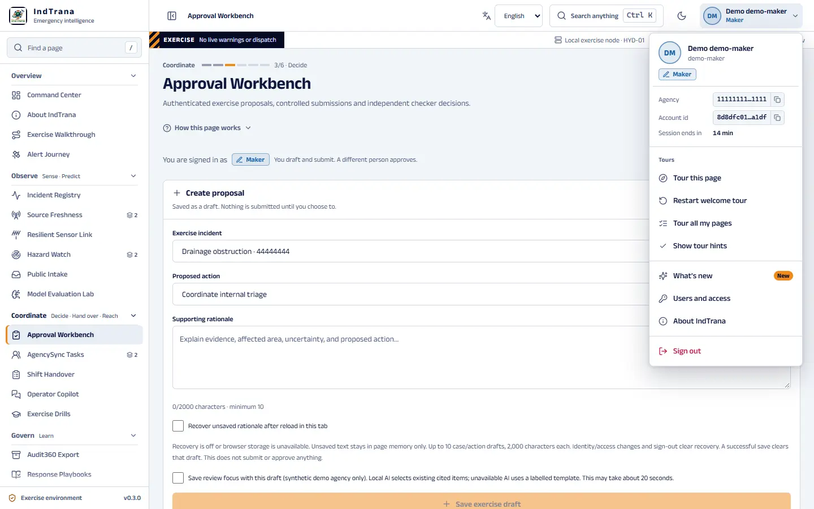

*Screenshot.* Account menu with tours and What's new. Address: top right. Captured 14 November 2026.

**What you are looking at.** Who is signed in (name, verified role, agency, session time left), a Tours group (Tour this page, Restart welcome tour, Tour all my pages, Show tour hints), What's new with a New marker, Users and access, About, and Sign out.

**How it is used.** Start a tour, open the release notes, or check that the role is the one expected before acting; sign out to change person.

**What it never does.** The name shown is display only; authority comes from the signed token.

#### 6.7 About IndTrana

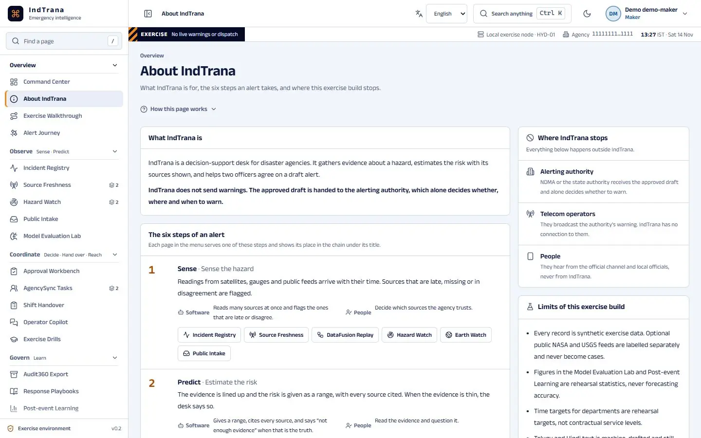

*Screenshot.* About IndTrana. Address: `/about`. Captured 14 November 2026.

**What you are looking at.** What IndTrana is for, the six steps an alert takes and the limits of this exercise build, with the patent credit.

**How it is used.** Read how the steps fit together and jump to the page that serves each step.

**What it never does.** It never describes real capability or real accuracy.

#### 6.8 Incident case

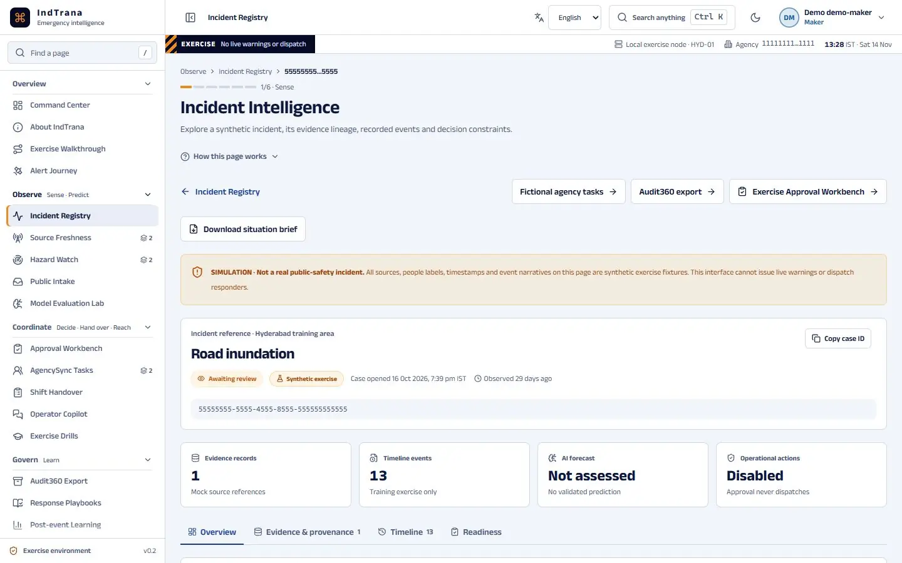

*Screenshot.* Incident case. Address: `/incidents/<id>`. Captured 14 November 2026.

**What you are looking at.** One exercise case: evidence with citations, readiness checks, explicit unknowns, nearby candidate sources and the team response.

**How it is used.** Read the evidence and what is missing before drafting a proposal.

**What it never does.** It never creates or changes a case, and the records are synthetic.

#### 6.9 Source Freshness

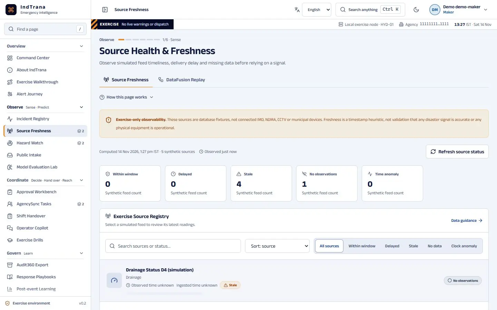

*Screenshot.* Source Freshness. Address: `/sources`. Captured 14 November 2026.

**What you are looking at.** How fresh each synthetic data feed is, and which feeds are late, missing or odd.

**How it is used.** Filter by state and open a feed to see its recent history.

**What it never does.** It never contacts a real agency feed, and agreement between feeds is not proof they are right.

#### 6.10 DataFusion Replay

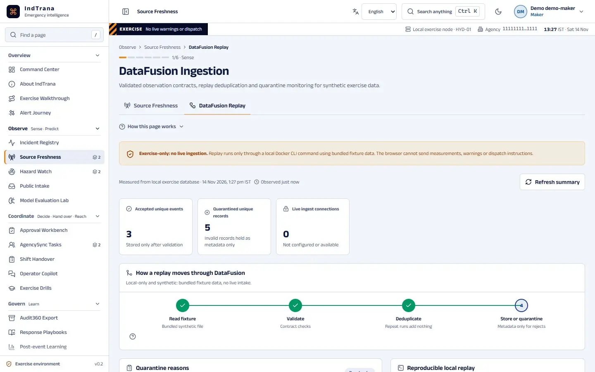

*Screenshot.* DataFusion Replay. Address: `/ingestion`. Captured 14 November 2026.

**What you are looking at.** The synthetic ingestion run: what was accepted, what was a duplicate and what was quarantined, with reasons.

**How it is used.** Read the counts and the reasons records were set aside.

**What it never does.** It never ingests live data or releases a quarantined record.

#### 6.11 Resilient Sensor Link

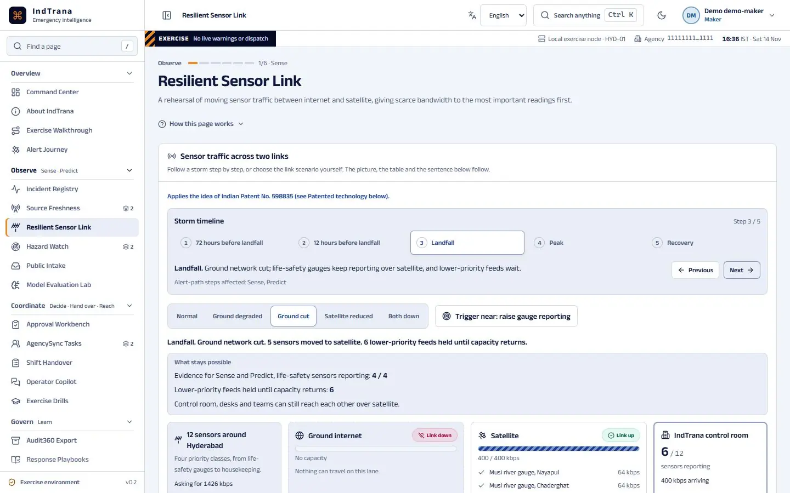

*Screenshot.* Resilient Sensor Link. Address: `/sensor-link`. Captured 14 November 2026.

**What you are looking at.** A rehearsal of sensor readings moving between a ground internet lane and a satellite lane, with a five-moment storm timeline and a What stays possible strip.

**How it is used.** Step through the timeline, or choose a scenario and the trigger-near option.

**What it never does.** It never transmits anything or uses a satellite or radio link. All values are synthetic.

#### 6.12 Hazard Watch

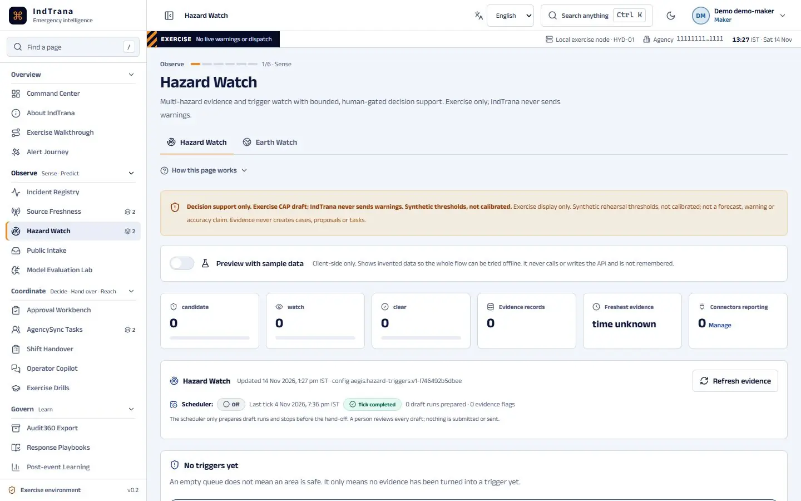

*Screenshot.* Hazard Watch. Address: `/watch`. Captured 14 November 2026.

**What you are looking at.** Hazard triggers that have crossed a threshold and need a person to look, with their evidence. Shows zeros while connectors are off; a preview with sample data is available.

**How it is used.** Read each candidate and its history. A maker can refresh the watch and start a proposal-linked run.

**What it never does.** It never issues a warning or acts on its own. Automation stops and hands over to a person.

#### 6.13 Alert Journey (exercise story)

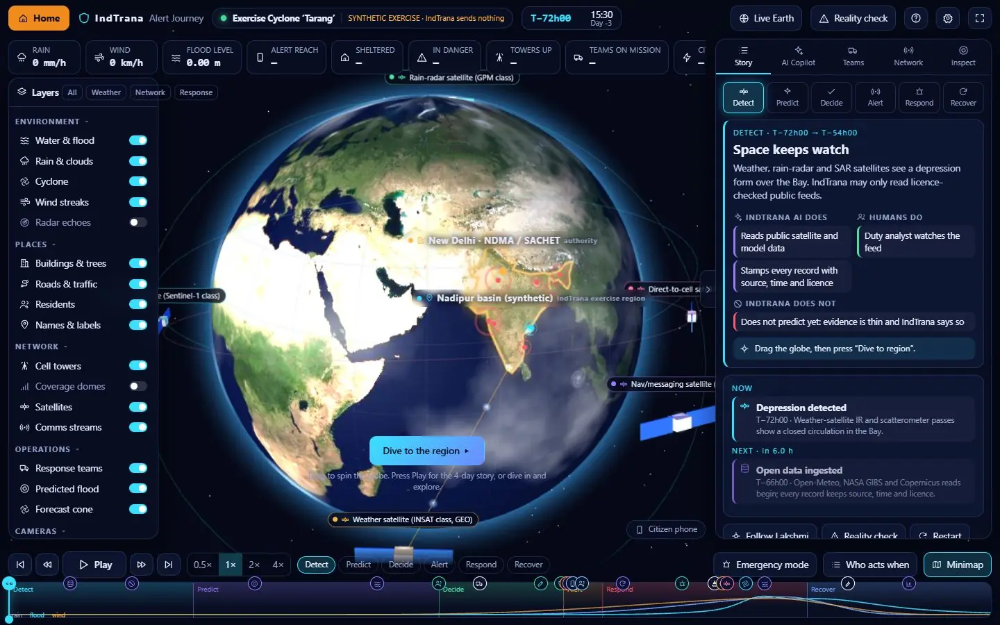

*Screenshot.* Alert Journey (exercise story). Address: `/alert-journey`. Captured 14 November 2026.

**What you are looking at.** A 3D synthetic cyclone story in six phases with three human decision gates.

**How it is used.** Play the story; it pauses at each gate until a person decides.

**What it never does.** It sends nothing. The 3D view is a story, not an operational picture.

#### 6.14 Alert Journey: Live Earth

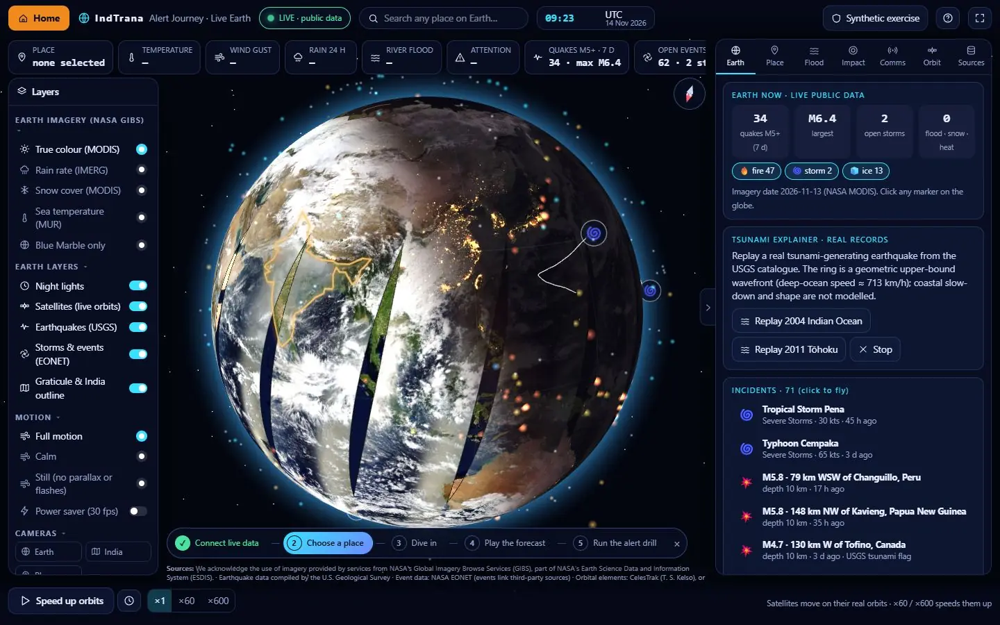

*Screenshot.* Alert Journey: Live Earth. Address: `/alert-journey`. Captured 14 November 2026.

**What you are looking at.** Opt-in public reference data on the globe: earthquakes, natural events, satellite imagery and orbits. Fetched by the IndTrana server, not by the browser.

**How it is used.** Accept the notice, then pick a place.

**What it never does.** Public data is display-only, never stored and never used to create a case or an alert.

#### 6.15 Live Earth: Flood tab

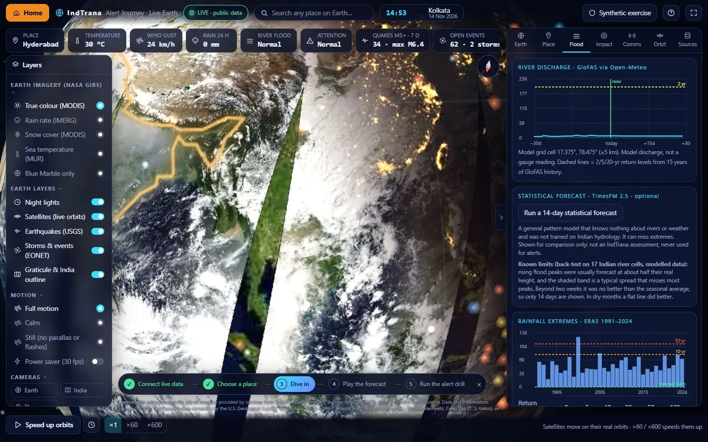

*Screenshot.* Live Earth: Flood tab. Address: `/alert-journey`. Captured 14 November 2026.

**What you are looking at.** River discharge for the chosen place as public model data, and an optional statistical estimate when that overlay is on.

**How it is used.** Read the ranges and the notes about missing data.

**What it never does.** It is model discharge, not a gauge reading or an IndTrana forecast. Hold-out figures are never called accuracy.

#### 6.16 Approval Workbench

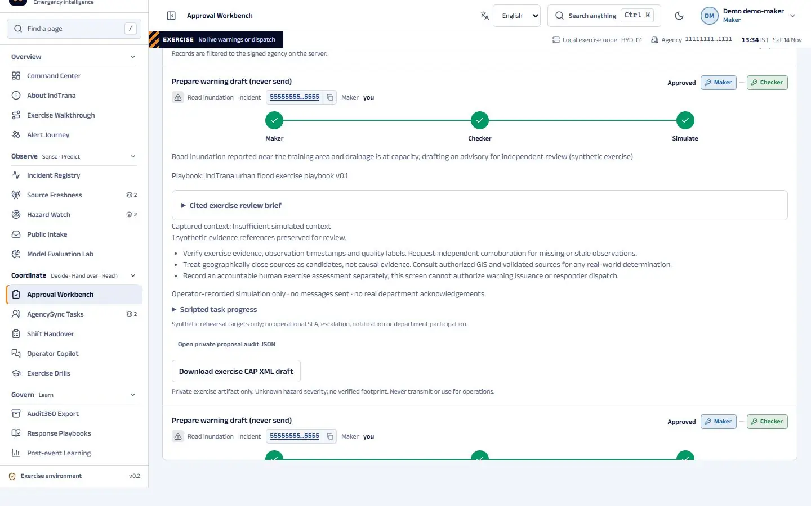

*Screenshot.* Approval Workbench. Address: `/approvals`. Captured 14 November 2026.

**What you are looking at.** Proposals for the agency and where each stands between its maker and its checker, shown as two keys.

**How it is used.** A maker drafts and submits. A different person, the checker, approves or rejects with a reason.

**What it never does.** It never lets one person submit and approve, and an approval never sends a warning. It produces a private draft.

#### 6.17 A page tour (Approval Workbench)

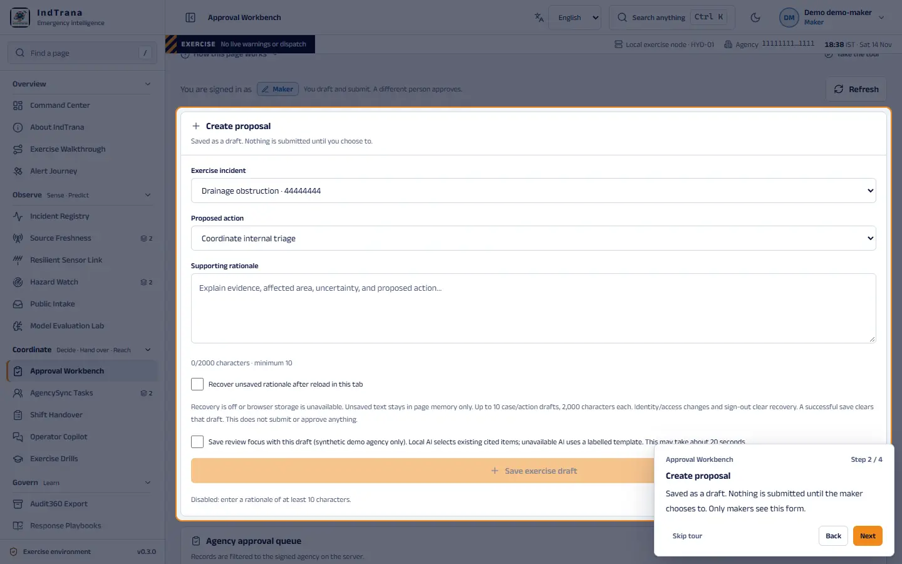

*Screenshot.* A page tour (Approval Workbench). Address: `/approvals`. Captured 14 November 2026.

**What you are looking at.** Step 2 of 4 of the page tour, taken as the maker: the Create proposal form is highlighted and a card explains it. Every page and tab has its own tour, and its steps are filtered by the signed-in role, so a checker sees different steps here.

**How it is used.** Start it with Tour this page in the account menu, or with the Take the tour button beside How this page works. Next and Back move the highlight; Skip tour or Escape ends it.

**What it never does.** Next only moves the highlight: a tour never fills in, submits or changes anything.

#### 6.18 A page tour on a phone

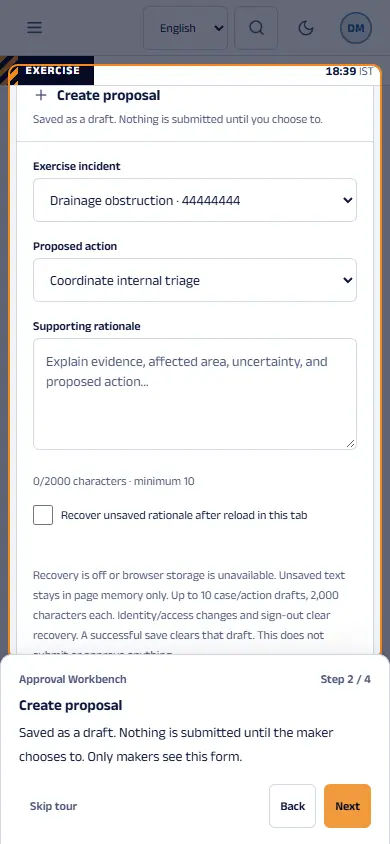

*Screenshot.* A page tour on a phone. Address: /approvals (390 px wide). Captured 14 November 2026.

**What you are looking at.** The same step at phone width: the card becomes a sheet at the bottom of the screen, with the highlighted form above it.

**How it is used.** The buttons are the same. The tour is keyboard operable and respects reduced motion.

**What it never does.** Skip tour and Escape always return you to the page.

#### 6.19 Department Inbox

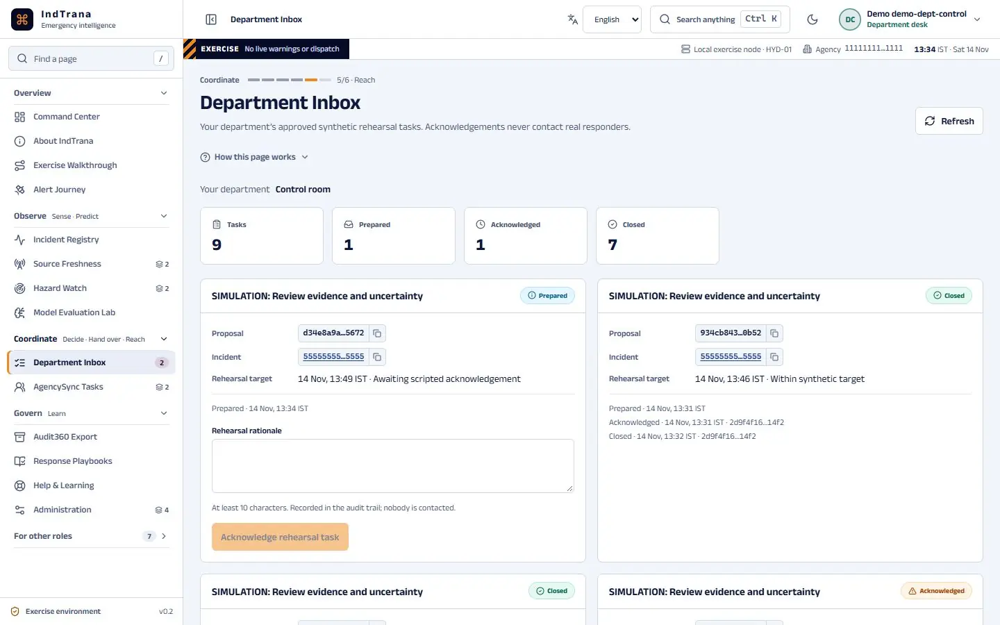

*Screenshot.* Department Inbox. Address: `/department-tasks`. Captured 14 November 2026.

**What you are looking at.** Approved tasks assigned to one department, with rehearsal time targets.

**How it is used.** Acknowledge a task and close it with a note; on an acknowledged task, request a team.

**What it never does.** It never shows another department's tasks and never calls, texts or radios anyone.

#### 6.20 Requesting a team

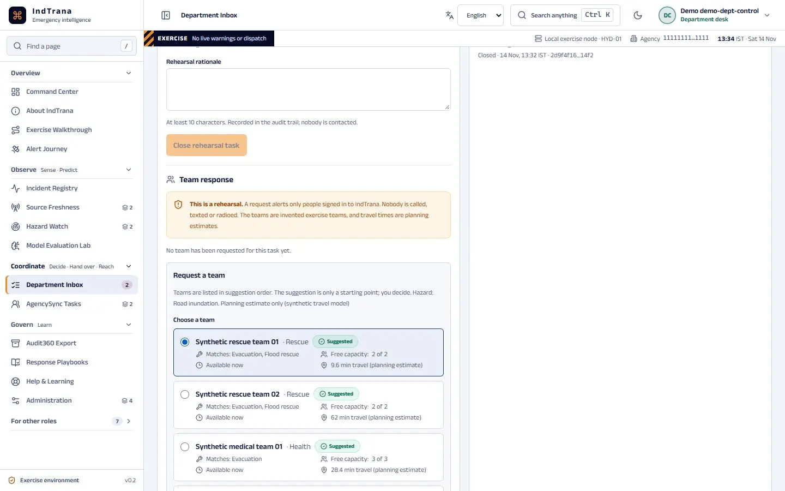

*Screenshot.* Requesting a team. Address: `/department-tasks`. Captured 14 November 2026.

**What you are looking at.** Why each invented team is suggested: matching capability, free capacity, availability now and an estimated travel time.

**How it is used.** The desk chooses one team and writes a note.

**What it never does.** Travel times are planning estimates; teams are invented, not real units.

#### 6.21 My Team (phone view)

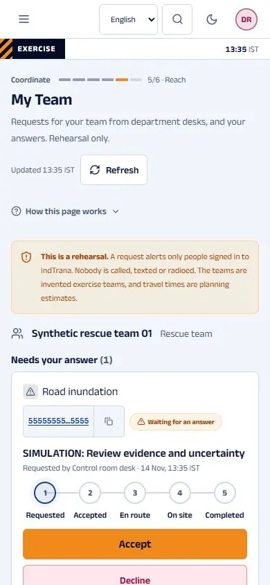

*Screenshot.* My Team (phone view). Address: `/my-team`. Captured 14 November 2026.

**What you are looking at.** The requests made to one team and the next action as one large button.

**How it is used.** Accept or decline, then report en route, on site and completed; send a situation report or ask for support.

**What it never does.** It never shows another team's requests, and nobody is contacted outside IndTrana.

#### 6.22 Team response on the incident

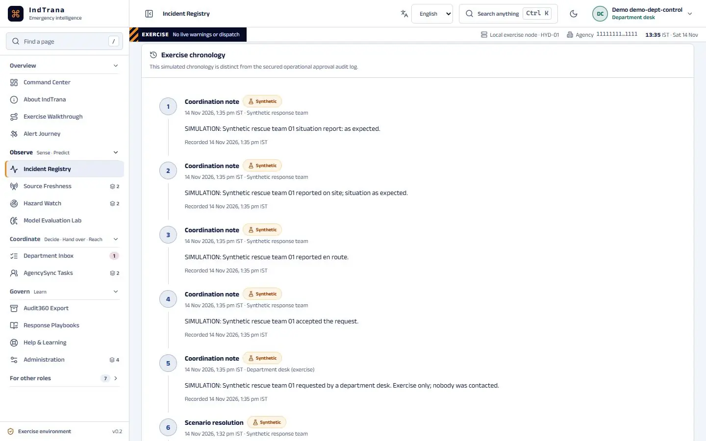

*Screenshot.* Team response on the incident. Address: `/incidents/<id>`. Captured 14 November 2026.

**What you are looking at.** A read-only panel and timeline lines, each starting with SIMULATION, built from fixed templates.

**How it is used.** Follow what each team reported and when.

**What it never does.** Notes never reach the timeline; the panel changes nothing.

#### 6.23 Team Availability

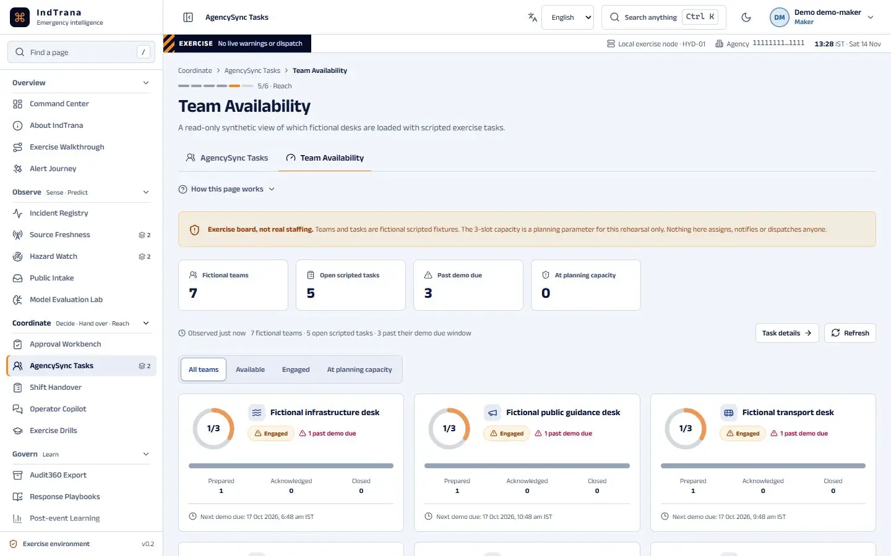

*Screenshot.* Team Availability. Address: `/response-teams`. Captured 14 November 2026.

**What you are looking at.** The workload of each fictional desk and the five invented field teams with their requests by state.

**How it is used.** See which desks are busy before a task is planned.

**What it never does.** It never moves, tasks or notifies a team.

#### 6.24 AgencySync Tasks

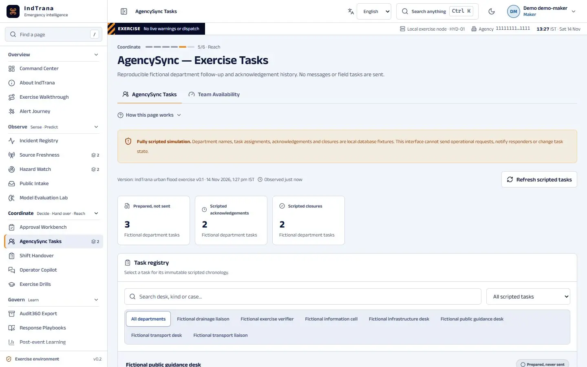

*Screenshot.* AgencySync Tasks. Address: `/agency-sync`. Captured 14 November 2026.

**What you are looking at.** Fictional acknowledgements and timelines from the departments in the exercise, with a task audit trail.

**How it is used.** Follow each task through acknowledgement and closure.

**What it never does.** It never messages a real agency.

#### 6.25 Shift Handover

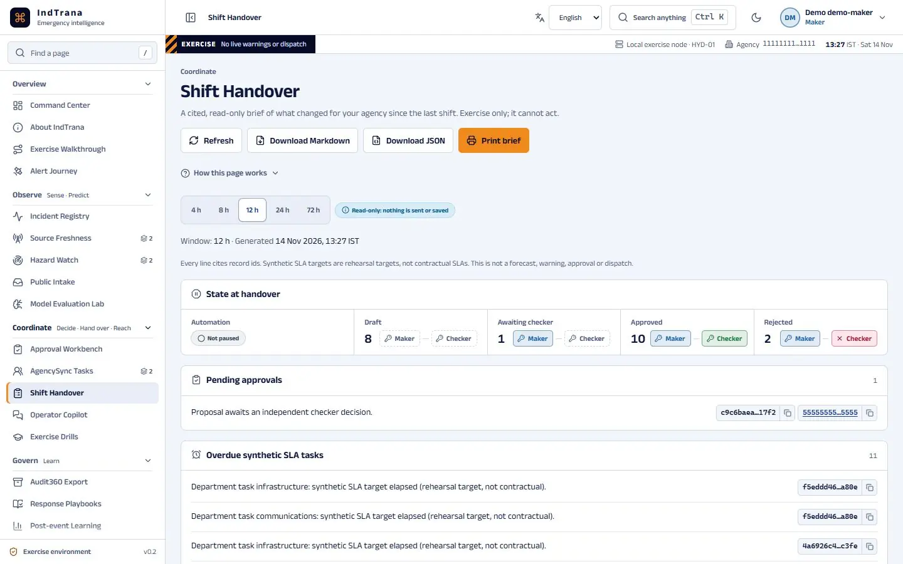

*Screenshot.* Shift Handover. Address: `/handover`. Captured 14 November 2026.

**What you are looking at.** What changed for the agency in a chosen 1 to 72 hour window, each line citing record identifiers.

**How it is used.** Choose the window, then download or print the brief.

**What it never does.** It never writes, saves or sends anything and is not a forecast.

#### 6.26 Operator Copilot

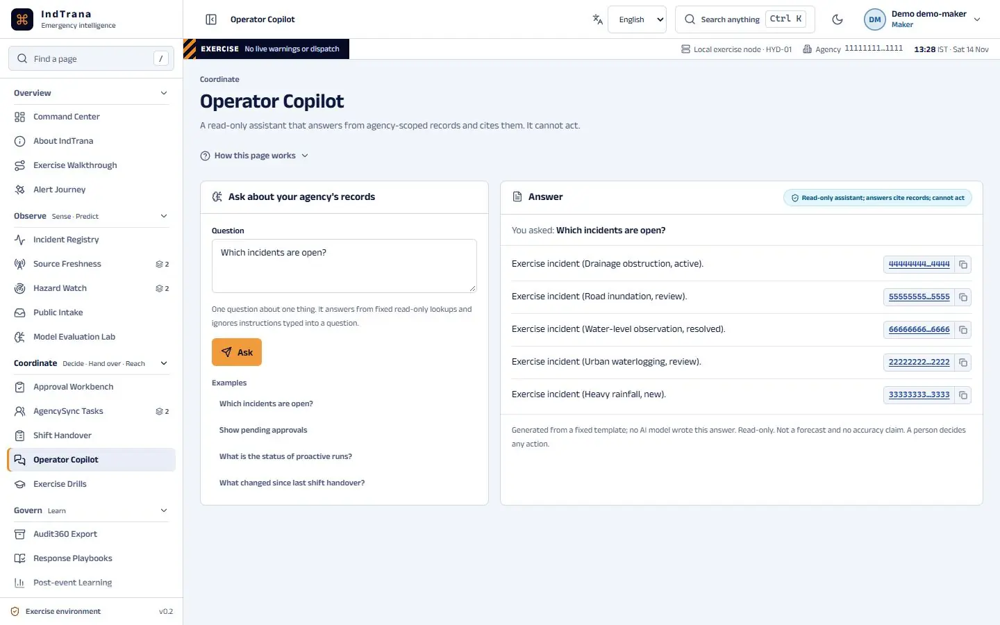

*Screenshot.* Operator Copilot. Address: `/copilot`. Captured 14 November 2026.

**What you are looking at.** Answers to a fixed set of questions about the agency's records, each with its sources.

**How it is used.** Ask one question at a time or pick an example.

**What it never does.** It never acts, approves, notifies or forecasts, and ignores instructions typed into a question.

#### 6.27 Exercise Drills

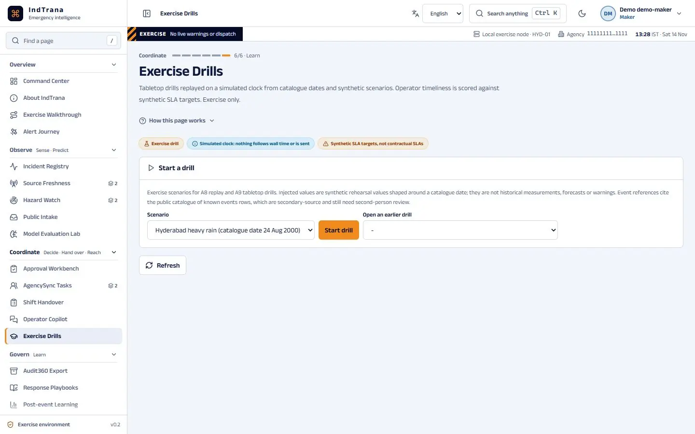

*Screenshot.* Exercise Drills. Address: `/drills`. Captured 14 November 2026.

**What you are looking at.** Timed tabletop drills on a simulated clock with a coach report.

**How it is used.** A maker starts a drill; makers and checkers respond to its injects.

**What it never does.** It never touches real records or sends anything. Scores are rehearsal targets.

#### 6.28 Post-event Learning

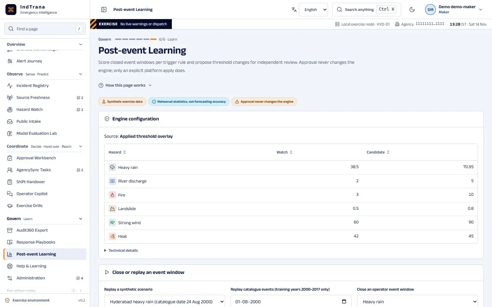

*Screenshot.* Post-event Learning. Address: `/learning`. Captured 14 November 2026.

**What you are looking at.** How earlier triggers compared with what happened in the exercise, labelled by basis.

**How it is used.** A maker proposes a threshold change; a different checker reviews it; only an administrator applies it.

**What it never does.** It never changes the engine on approval alone, and the statistics are never accuracy.

#### 6.29 Audit360 Export

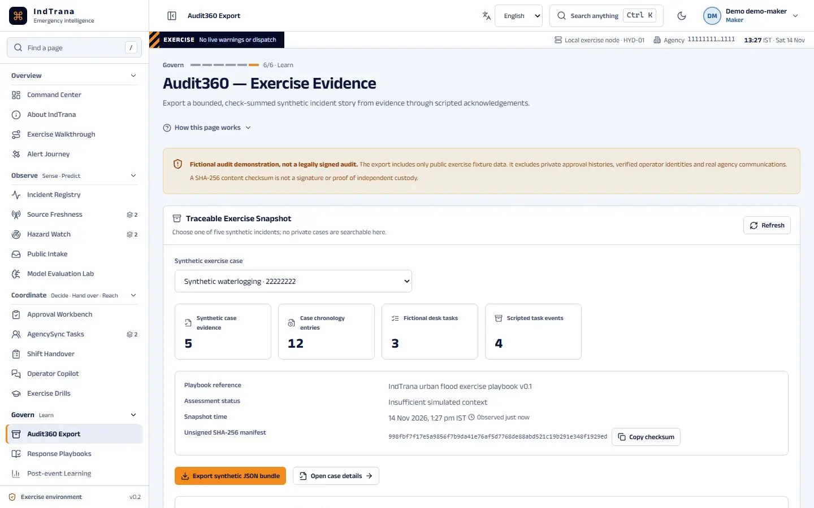

*Screenshot.* Audit360 Export. Address: `/audit`. Captured 14 November 2026.

**What you are looking at.** The provenance of one exercise case, with a checksum.

**How it is used.** Download the bounded export and verify its checksum.

**What it never does.** It never exports credentials, checker notes or another agency's records.

#### 6.30 What's new

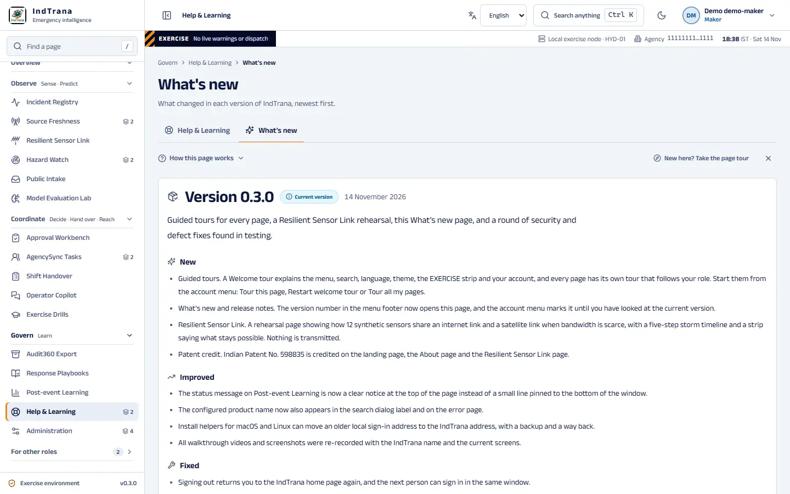

*Screenshot.* What's new. Address: `/whats-new`. Captured 14 November 2026.

**What you are looking at.** Release notes for each version, newest first, grouped as New, Improved, Fixed and Security, with the current version marked. 0.3.0 (14 November 2026) is the first tagged release; earlier entries are summaries of earlier work.

**How it is used.** Open it from What's new in the account menu or from the version number at the foot of the sidebar; read the notes in plain wording.

**What it never does.** It changes no record. It makes no claim of real warnings, dispatch or forecast accuracy.

#### 6.31 Users and access

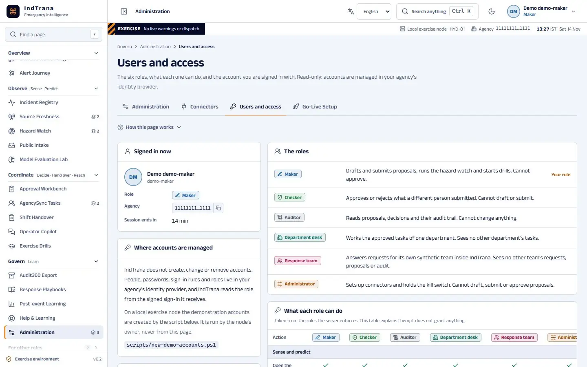

*Screenshot.* Users and access. Address: `/admin/users`. Captured 14 November 2026.

**What you are looking at.** The six roles, what each can do, and the account you are signed in with.

**How it is used.** Check what your role allows and where accounts are managed.

**What it never does.** It never creates, changes or removes an account; that is done at the identity provider.

#### 6.32 Administration

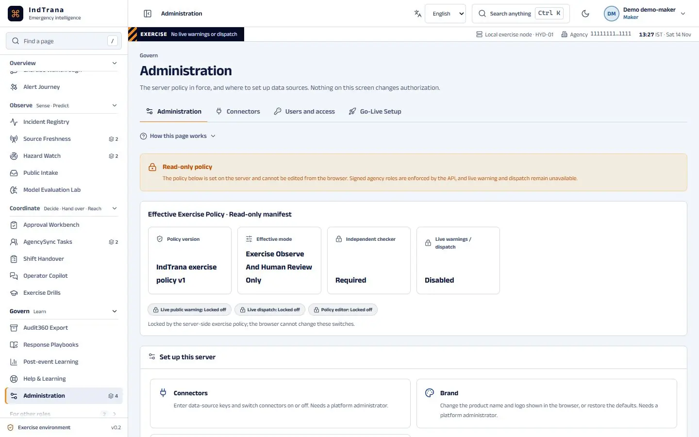

*Screenshot.* Administration. Address: `/admin`. Captured 14 November 2026.

**What you are looking at.** The server policy and the safety switches of this exercise node.

**How it is used.** Read every setting. An administrator can engage or release the kill switch.

**What it never does.** It never enables live warnings or dispatch from this page.

## 7 Communication and the patented sensor-link idea

### 7.1 How IndTrana reaches people

Public warnings are a different subject: IndTrana never sends them. An authorised officer hands the approved CAP draft to the alerting authority, whose own system reaches telecom operators and phones. What IndTrana can do is reach its own signed-in staff.

**Table 11.** Communication channels today

| Channel | State | Who it reaches | Leaves the server? |
| --- | --- | --- | --- |
| In-app alerts | In use | People signed in: counts on the menu, Department Inbox, My Team, Approvals | No |
| Email notices | Can send; off by default (two switches) | IndTrana staff of the same agency who opted in, at their verified sign-in address; fixed rehearsal templates only | Yes, when both switches are on |
| SMS | Credentials check only; sending locked | Nobody | Only the credential check |
| WhatsApp | Credentials check only; sending locked | Nobody | Only the credential check |
| Mobile push | Not built | Nobody | No |

On 12 November 2026 the project owner lifted the no-dispatch rule for one thing only: email notices to IndTrana's own signed-in staff who have opted in. Sending needs the host switch and the email connector enabled; the connector switch is the kill switch and is read before every send. Each person opts in on the Help page; the address is never typed and comes only from the verified token. Two fixed templates exist: a test notice to oneself and an approval-waiting notice to opted-in checkers of the same agency (never the maker). Neither carries any incident, proposal or personal content. The only module that calls a send endpoint is staff_messages.py, and a test fails if the provider host or a send call appears anywhere else.

### 7.2 Resilient Sensor Link

Indian Patent No. 598835 (Application No. 201741007139, filed 28 February 2017, granted 12 August 2026) is titled “Dynamic Bandwidth System for IoT Networks via Satellite and Internet Infrastructure”. The patentee is Bharath Bejjarapu, a co-owner of IndTrana. The patent is described here from its title and from a public listing of the publication notice, which says the published application describes an aggregated IoT platform with dedicated IoT networks connected by satellite and internet infrastructure, for providing bandwidth on demand; that listing was not verified against the Patent Office record, and the full specification has not been reviewed. IndTrana itself is not described as patented, and nothing here states what the patent's claims cover.

IndTrana applies the idea named in the title to its Sense step and to control-room, desk and team contact, as a rehearsal. The signed-in Resilient Sensor Link page is a browser-only simulation: twelve synthetic sensors in four priority classes ask for bandwidth from two lanes, a ground internet lane and a satellite lane (Figure 13). A five-moment storm timeline selects one of the link scenarios for each moment, and a strip shows what stays possible. The priority classes and switch-over rules are IndTrana's own rehearsal choices.

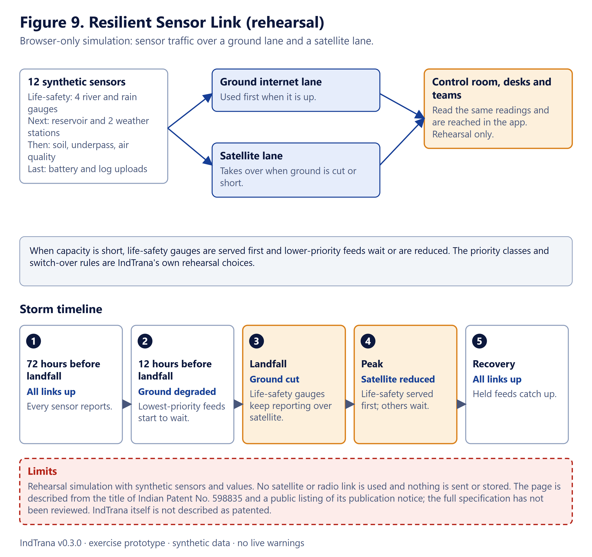

**Figure 13.** Resilient Sensor Link concept and storm timeline (rehearsal simulation; nothing is transmitted).

Limits: nothing is transmitted, no satellite or radio link is used, no network call is made and nothing is stored; all values are synthetic. A field deployment would need the items listed in Table 12.

**Table 12.** Open items for a sensor-link field deployment (not facts about the patent)

| Still needed for a field deployment |
| --- |
| Sensor gateways able to use both link types |
| Satellite terminals and licensed capacity from an authorised provider |
| A bandwidth policy agreed with the agency |
| Security review of the links |
| Testing against real outages |
| Review of the patent specification by its owner |

## 8 Deployment

### 8.1 Today

IndTrana runs as exactly one Docker Compose project on one computer. Windows 10 and 11 are the tested system; Linux and macOS start paths are written but have not been run there. One command per system installs what is missing, sets up local sign-in with demonstration accounts and starts one copy; the database volume is kept across restarts. Nothing in the repository creates cloud resources.

### 8.2 What a government deployment would still need

Figure 14 sets today's laptop beside the items that are not yet built. The list below uses the status words of the project's readiness document, written on 11 November 2026 from secondary sources; every clause must be confirmed against the official text. It is not legal or compliance advice, and IndTrana is not ready for government production use.

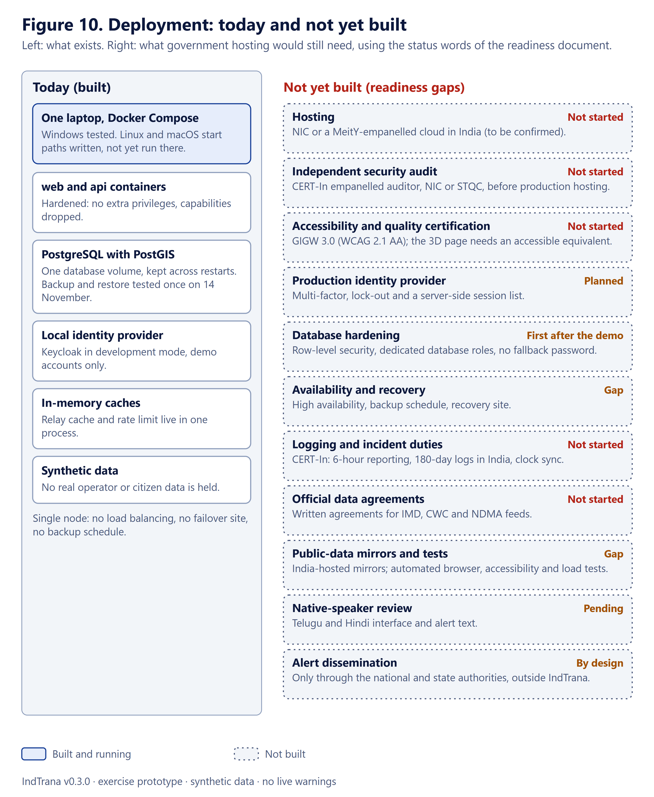

**Figure 14.** Deployment views: today's laptop and what government hosting would still need (not yet built).

**Table 13.** Readiness gaps, with the status words of the readiness document

| Area | Summary (to confirm against the official text) | State |
| --- | --- | --- |
| Hosting | NIC infrastructure or a MeitY-empanelled cloud in India (not verified in the source; confirm with NIC/MeitY) | Not started |
| Security audit before hosting | Audit and clearance certificate from NIC, STQC or a CERT-In empanelled auditor | Not started |
| GIGW 3.0 and accessibility | WCAG 2.1 Level AA; STQC website quality certification; the 3D page needs an accessible equivalent | Not started |
| CERT-In Directions, 28 April 2022 | 6-hour incident reporting, 180-day logs in India, clock synchronisation, a point of contact | Not started (operations duty) |
| DPDP Act 2023 and Rules 2025 | Breach notice and reasonable security safeguards | Not applicable while data is synthetic; applies once real data is held |
| Official data sources | Written agreements for IMD, CWC / India-WRIS and NDMA SACHET data | Not started; connectors refuse to run without them |
| Alert dissemination | Only through NDMA, state SDMA and SACHET to operators' cell-broadcast centres | Outside IndTrana by design |
| Procurement and IP | Third-party data licences are non-commercial; a patent or commercial plan needs legal review | See research/real-data/LICENCES.md |
| Sign-in strength | Multi-factor, password rules and lock-out are the identity provider's job | Agency must switch them on at its provider |
| Availability | Free public APIs with no service guarantee | Needs paid plans, agreements or self-hosted mirrors |
| Scale | Single node, one database, in-memory caches | No high availability, backup schedule or recovery site |
| Tests | No automated browser or accessibility tests in the repository | Gap (scripted checks were kept outside the repository) |
| Translations | Telugu and Hindi text is machine-drafted | Needs native-speaker review |
| Style policy | style-src still allows inline styles (scripts do not) | Known weakness |

## 9 Status and limits

These statements apply to every other section of this document.

- IndTrana is a local synthetic demonstration prototype for rehearsal. It is not a live warning system.
- It sends no public warning, dispatches no team and contacts no outside agency. The only message it can send is a fixed-text email notice to its own signed-in staff who opted in, and only when two switches are on (off by default).
- All data is synthetic exercise data. Public reference feeds (Earth Watch, Live Earth) are optional, display-only and never create cases, proposals or alerts.
- Rehearsal statistics and the synthetic model scores are not forecasting accuracy.
- It has no government approval or certification of any kind.
- Security testing so far is a developer self-assessment by the development assistant, not an independent audit or penetration test.
- Telugu and Hindi text is machine-drafted and awaits native-speaker review; 1157 interface strings are listed as pending, and translated alert blocks are pending sign-off.
- Linux and macOS start paths are written but have not been run there; all test results are from one Windows laptop.
- Two live agencies and two real human approvers have not been tested; demo accounts do not establish real two-person approval.

### 9.1 How to cite this submission

**Table 14.** Citation details for this submission

| Item | Value |
| --- | --- |
| Product | IndTrana, local synthetic demonstration prototype |
| Product version | 0.3.0 (first tagged release) |
| Repository branch | Aegis_IndTrana |
| Release tag | v0.3.0 (commit a97d9fc) |
| Document date | 14 November 2026 |
| Word document | IndTrana-Technical-Architecture-v0.3.0.docx |
| PDF | IndTrana-Technical-Architecture-v0.3.0.pdf |
| Markdown edition | IndTrana-Technical-Architecture-v0.3.0.md (with its assets folder) |
| Interactive page | IndTrana-Overview-v0.3.0.html |

## 10 Testing and evidence

All results below are from the Windows laptop on 14 November 2026. Nothing was run on Linux or macOS. They were produced by the development assistant, not by an independent party, and demonstration accounts do not establish real two-person approval.

**Table 15.** Test evidence of 14 November 2026 (Windows laptop)

| Check | Result |
| --- | --- |
| API test suite (pytest) | 1379 passed, 30 skipped (the skipped tests need a database and are opt-in) |
| Model evaluation check (python -m app.model_lab --check) | PASS: recomputes the synthetic report exactly |
| Web type check | Clean |
| Web Node tests | 401 passed |
| Security smoke script | PASS |
| Demo-readiness script | GO |
| Backup and restore check | Passed: a dump restored into a throwaway database with equal counts |
| Page crawl, 8 accounts, 29 pages, two views | 464 loads: no page error, no server error, no sideways scroll |
| End-to-end run, 8 accounts | 496 page loads (31 routes, 1440 px light and 390 px dark) and 1310 clicks across six roles: no page error and no server error |
| Dependency scans | npm audit: 0; pip-audit: none |
| Pending translations | 1160 interface strings in English until native review (list in lib/translations-pending.ts) |

Not tested: two live agencies; a real second person as checker; a screen reader; colour-contrast measurement; print; the statistical forecast with the model loaded; staff email with a real provider; Linux and macOS.

## 11 Version history

0.3.0 is the first tagged release. The product's package file said 0.2.0 from the first commit and no tag was ever created, so 0.2.0 and 0.1.0 are summaries of earlier work with a period instead of a release date. They have no tag. The entries follow the repository's own release notes and CHANGELOG.md.

Figure 15 places the observed events of the repository history on one time line. The time zone is Asia/Kolkata and one quiet period is compressed.

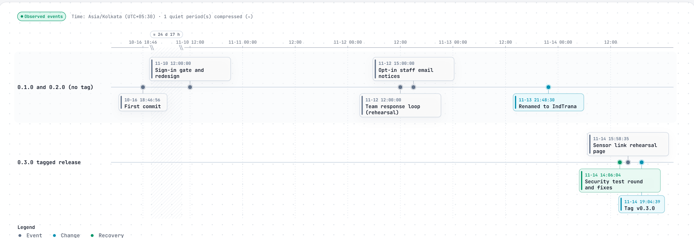

**Figure 15.** Version timeline of observed repository events (Archify, landscape page). 0.1.0 and 0.2.0 have no tag; 0.3.0 is tagged v0.3.0.

#### 0.3.0 (14 November 2026, the first tagged release)

- Guided tours (a Welcome tour and one tour per page and tab, following your role) and a What's new page with release notes.
- The Resilient Sensor Link rehearsal page with its storm timeline, and the patent credit (Indian Patent No. 598835).
- A round of security and defect fixes found in testing: an origin check on one web route, platform-wide administration limited to the exercise agency's administrator, defensive API headers, escaping of three public-feed values, stricter request models, and a sign-out repair.
- Walkthrough screenshots and videos re-recorded with the IndTrana name.

#### 0.2.0 (Summary of earlier work (no tagged release), up to 13 November 2026)

- The product became IndTrana, with sign-in for every page and data route, administrator brand settings, department and team accounts, and one-step install for Windows, macOS and Linux. Everything is still a local exercise on synthetic data.
- Team response loop (rehearsal inside the app), opt-in email notices to IndTrana's own staff behind two switches, and communication channels on the Connectors page for credentials only.

#### 0.1.0 (Summary of earlier work (no tagged release), October 2026)

- The first local synthetic demonstration of the alert path, from evidence to an approved exercise draft.
- Incident registry and workspace, source freshness and DataFusion replay, proposals with independent two-person approval, an approved-only alert draft, exercise tasks for departments, and a model evaluation lab that states its figures are not real forecasting accuracy.

## 12 Interactive edition and how to use it

Four files accompany this version. Each tells the same story at a different level of interaction; none adds a claim that this document does not make.

**Table 16.** The four files of this submission

| File | What it is | How to open it |
| --- | --- | --- |
| IndTrana-Overview-v0.3.0.html | The interactive page: one self-contained file | Double-click it. It works from disk, offline, and makes no network request. |
| IndTrana-Technical-Architecture-v0.3.0.docx | This document in Word format | Open in Word. Update fields (Ctrl+A, F9) if the contents list shows only a placeholder. |
| IndTrana-Technical-Architecture-v0.3.0.pdf | The same document as a fixed PDF with bookmarks | Open in any PDF viewer; zoom into the landscape diagram pages. |
| IndTrana-Technical-Architecture-v0.3.0.md | The Markdown edition, with an assets folder of images beside it | Read it in a Markdown viewer or on a repository page; keep the .md file and its assets folder together. |

### 12.1 The interactive page

IndTrana-Overview-v0.3.0.html is a single file. All of its script, style, fonts, images and the three-dimensional library are inside it; it loads nothing from the internet, so it works offline by double-click and sends no data anywhere. It offers:

- **Layered 3D architecture explorer.** The runtime shown as layers in three dimensions. A block can be selected to see its detail, a list of the blocks gives the same selection by keyboard, and a Trace a request control walks a sign-in, a page load or the saving of a proposal through the layers with a caption for each hop.
- **3D storm timeline.** The Resilient Sensor Link rehearsal as a five-moment storm timeline, with the same figures the application's page shows. It is a rehearsal simulation; nothing is transmitted.
- **Seven diagrams.** The seven Archify diagrams: architecture, sign-in sequence, proposal life cycle, data model, alert path, version timeline and repository tree. This document uses six of them; the hand-made alert-path figure stays in Figure 1.
- **Tables.** Tables that can be sorted and filtered.
- **Markdown document viewer.** The Markdown edition of this document can be read inside the page.
- **Command palette.** A keyboard-driven way to jump to a section or a control.
- **Appearance and motion.** A light and a dark theme, a control to pause motion, respect for the system's reduced-motion setting, and a print layout.

If the browser cannot draw three-dimensional graphics, the page shows a flat two-dimensional diagram instead and every fact stays available in text. The page's own on-page help is the authority for the exact controls.

### 12.2 The Markdown edition

IndTrana-Technical-Architecture-v0.3.0.md carries the same sections, tables, use cases, walkthrough, version history and glossary as this document, with the same numbering and the same figure captions. Its images are in the folder IndTrana-Technical-Architecture-v0.3.0-assets, referenced by relative paths, so the file and the folder must stay together. It uses plain GitHub-flavoured Markdown (headings, tables, images and links) with no diagrams drawn from code and no embedded HTML.

## Glossary

**Table 17.** Glossary

| Term | Meaning |
| --- | --- |
| Agency | An organisation using IndTrana. Every record belongs to one agency, and a person sees only their agency's records. |
| API | Application programming interface: the server program that holds the rules and talks to the database. |
| Audit trail | The permanent record of who did what, when and why. |
| Backend for the browser (BFF) | The server layer of the web application that keeps tokens and sessions so the browser never holds them. |
| CAP | Common Alerting Protocol: the standard format for an alert message. IndTrana only produces a private Draft CAP file marked Exercise. |
| Checker | The person who approves or rejects a proposal drafted by someone else. |
| Content Security Policy (CSP) | A browser rule that limits which scripts and connections a page may use. |
| Docker Compose | A tool that starts several programs (containers) together on one computer. |
| Exercise | A rehearsal on synthetic data. Nothing in an exercise is real or sent. |
| Identity provider | The agency's sign-in service. It holds passwords and second factors and issues signed statements of who a person is. |
| Kill switch | An administrator control that stops automated watch and scheduling at once. |
| Maker | The person who drafts and submits a proposal. |
| Maker-checker | A rule that two different people must draft and approve a consequential step. |
| OIDC | OpenID Connect: a standard way for an application to ask an identity provider who a person is. |
| PKCE | A protection that stops a stolen sign-in code being reused by someone else. |
| PostGIS | A PostgreSQL extension for maps and locations. |
| Proposal | A drafted action (for example a warning draft) with evidence, waiting for independent review. |
| Row-level security | A database feature that limits which rows a database account can read. Not yet built here. |
| Synthetic data | Invented data that looks like real data but describes no real event. |
| Token | A signed digital statement of identity, agency and role. In IndTrana it stays on the server. |
| Trust boundary | A line across which data must be checked again because the other side is not fully trusted. |

## List of figures

Figure 1.  The alert decision path: where software assists, where a person decides and where IndTrana stops.

Figure 2.  Roles and what each can do, from the role matrix in the web application.

Figure 3.  Proposal life cycle: states, steps and the role that performs each change.

Figure 4.  Proposal, task and team-request states (Archify state diagram, landscape page). The earlier figure, with the role for each step, is kept because it shows who performs each change.

Figure 5.  System context: users, identity provider, optional connections and what is deliberately not connected.

Figure 6.  Runtime architecture under Docker Compose, with ports and optional overlays.

Figure 7.  Runtime architecture, request-path view (Archify, landscape page). It supplements Figure 6, which reads better as the detailed reference.

Figure 8.  Sign-in and request sequence: the sign-in dance with the identity provider, the hand-back of the sealed session, and a verified request (Archify sequence diagram, on a landscape page; it replaces the earlier eleven-step flow figure).

Figure 9.  Logical data model: table groups and the main links between them.

Figure 10.  Entity-relationship diagram: 25 tables in six groups with key columns (Archify, landscape page; not every column is shown).

Figure 11.  Repository layout (Archify tree). The image is tall, so it is scaled to fit one page and is narrower than the text width.

Figure 12.  Trust boundaries and the controls at each layer, with the 14 November test summary.

Figure 13.  Resilient Sensor Link concept and storm timeline (rehearsal simulation; nothing is transmitted).

Figure 14.  Deployment views: today's laptop and what government hosting would still need (not yet built).

Figure 15.  Version timeline of observed repository events (Archify, landscape page). 0.1.0 and 0.2.0 have no tag; 0.3.0 is tagged v0.3.0.

## List of tables

Table 1.  Document control

Table 2.  Module names used in the project's vision document. Section 6 shows what exists as pages today.

Table 3.  Main design decisions and their reasons

Table 4.  The six roles

Table 5.  Containers and published ports. Everything listens on the loopback address only.

Table 6.  Optional overlays and their switches

Table 7.  Technology choices and reasons

Table 8.  Claims the API requires (names keep the aegis prefix; see How to read this document)

Table 9.  Tests carried out on 14 November 2026

Table 10.  Findings of the 14 November test and their status

Table 11.  Communication channels today

Table 12.  Open items for a sensor-link field deployment (not facts about the patent)

Table 13.  Readiness gaps, with the status words of the readiness document

Table 14.  Citation details for this submission

Table 15.  Test evidence of 14 November 2026 (Windows laptop)

Table 16.  The four files of this submission

Table 17.  Glossary
